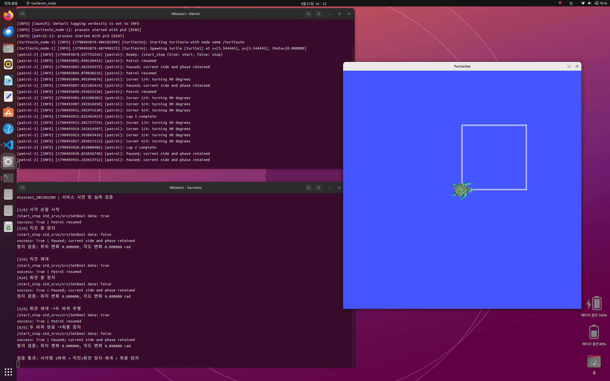
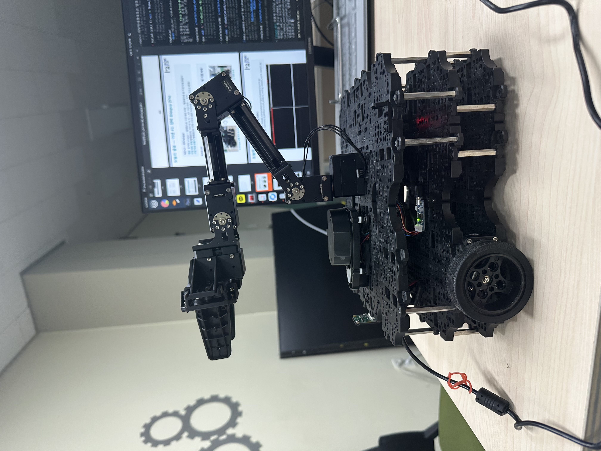
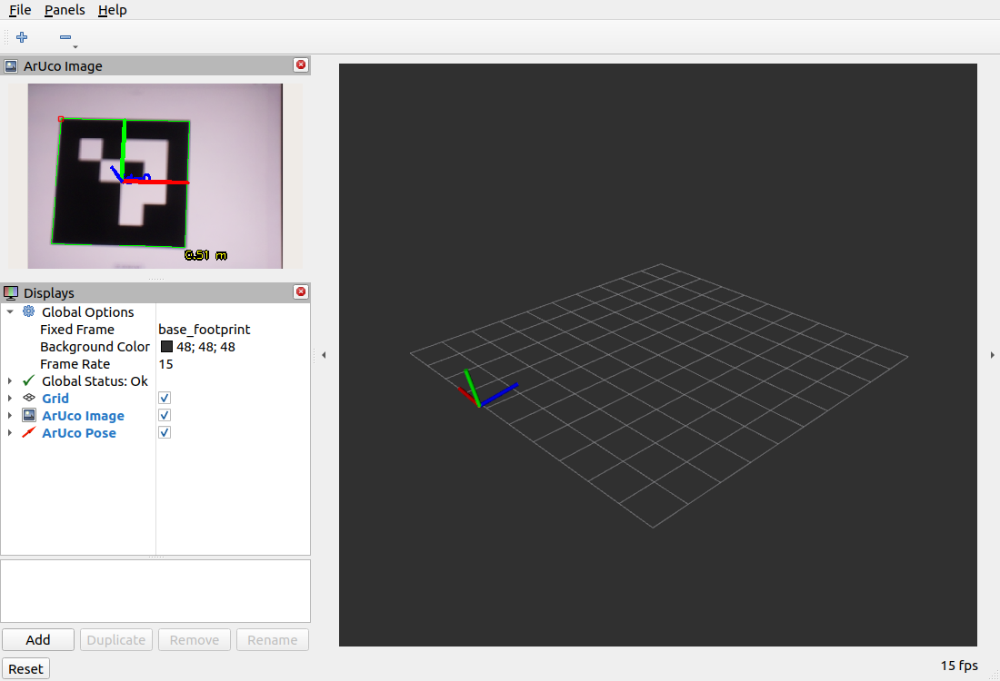
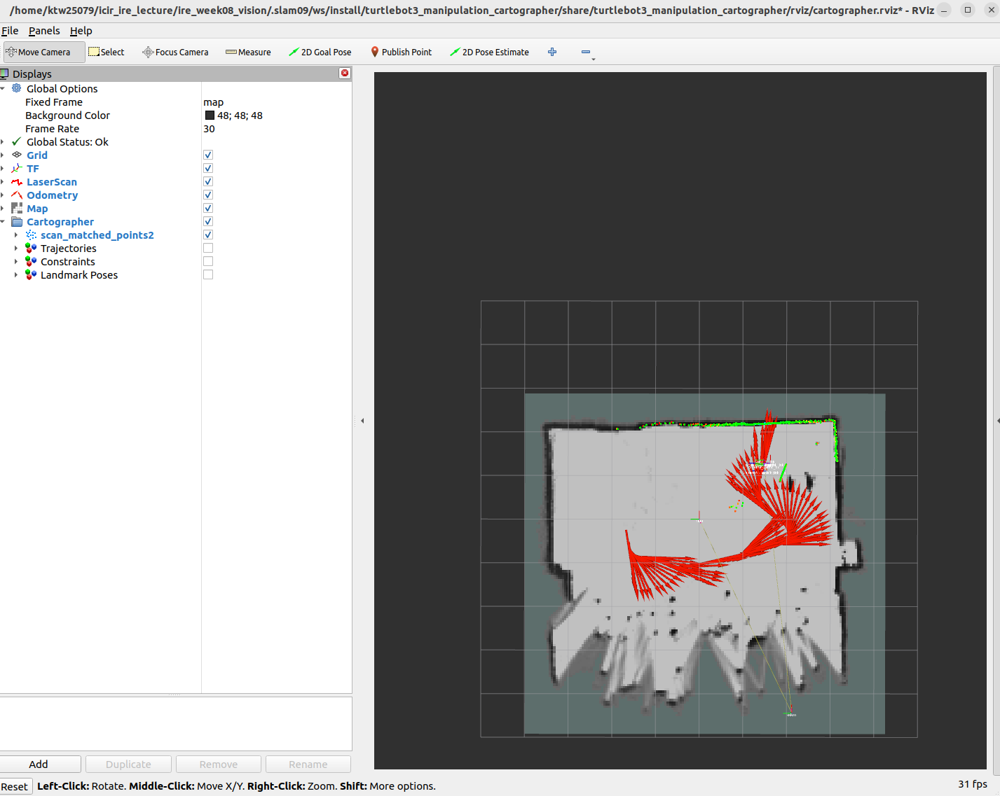
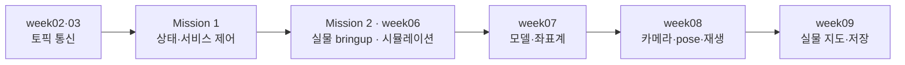

# Intelligent Robot Practice

**ROS 2 통신에서 실물 로봇 제어·시각 인식·SLAM까지, 코드와 실행 근거를 함께 기록한 실습 저장소.**

강태욱 · 202302200 · 2026년 2학기 · Ubuntu 22.04 / ROS 2 Humble

[](https://github.com/ktw25079/Intelligent_Robot_Practice/actions/workflows/verify.yml)

[실습별 코드](#실습-목록) · [재현 안내](docs/REPRODUCIBILITY.md) · [검증 범위](docs/EVIDENCE.md) · [코드 출처와 기여](docs/PROVENANCE.md)

## 대표 결과

| 서비스 기반 사각 순찰 · Mission 1 | 실물 하드웨어 제어 · Mission 2 |
| --- | --- |
| [](mission1/README.md) | [](mission2/README.md) |
| 상태를 보존하는 정지·재개, 두 바퀴 시연, pose 기반 정지 검사 | 컨트롤러 5개 활성화, 바퀴 주행·팔 자세 변경 |

| 카메라 검출과 재생 · week08 | 실물 지도 작성 · week09 |
| --- | --- |
| [](week08/README.md) | [](week09/README.md) |
| ID 0·pose 검출, 영상과 보정 정보 60개 메시지 기록·재생 | 이중벽 관찰 후 속도 제한, PGM·YAML 저장·재로드 |

사진은 실제 실행 자료이며 각 링크에서 명령·설정·로그와 확인하지 못한 범위를 함께 볼 수 있다. SLAM 지도에는 일부 미관측 영역과 번짐이 남아 있다.

## 구현에서 검증까지

- **제어 구조:** 사각 순찰의 운동 제어기를 ROS 노드와 분리했다. 첫 방향을 기준으로 회전 목표를 정하고 정지 시 현재 변과 단계를 유지한다. [제어기](mission1/mission1_202302200/mission1_202302200/square_motion.py) · [수치 시험](mission1/mission1_202302200/test/test_square_motion.py)
- **관측 가능한 결과:** 화면뿐 아니라 서비스 응답, pose, TF, rosbag과 지도 파일을 보관한다. 실시간 입력과 bag 재생을 분리해 검출 재현 여부를 확인했다. [재생 검사값](week08/results/verification.json)
- **오류 분석:** 카메라 촬영 시간 초과의 케이블·모듈 비교, OpenCR 통신 보정, 회전 속도와 이중벽을 실행 근거와 함께 설명한다. [카메라](week08/docs/troubleshooting.md) · [OpenCR](mission2/docs/hardware-repair.md) · [SLAM](week09/README.md)



## 실습 목록

| 실습 | 구현·적용한 내용 | 확인한 결과 | 실행 환경 |
| --- | --- | --- | --- |
| [week02](week02/README.md) | 기본 pub/sub 데모와 Python 대응 코드 | 같은 번호의 메시지 발행·수신 로그 | PC / ROS 데모 |
| [week03](week03/README.md) | Python 패키지·파라미터·remapping | 학번 노드·토픽, rqt_graph 연결 | PC / ROS 노드 |
| [Mission 1](mission1/README.md) | pose 기반 사각 순찰, SetBool 정지·재개 | 두 바퀴 시연, 직진·회전 정지 검사 | turtlesim |
| [Mission 2](mission2/README.md) | 팀 제공 ROBOTIS 작업공간 구성·실물 운용 | 컨트롤러 5개 active, 수동 주행·팔 자세 | Pi + TurtleBot3 |
| [week06](week06/README.md) | Gazebo·RViz·RQt 통합, 베이스 teleop | LaserScan·영상·속도 명령 그래프 | Gazebo |
| [week07](week07/README.md) | URDF 4링크·3종 관절, launch 설정 | 관절 슬라이더와 TF 변환·트리 | RViz / TF |
| [week08](week08/README.md) | 강의 ArUco 예제의 실물 적용·rosbag 검증 | CSI 카메라 ID·pose 재생, C920 ID 검출 | Pi 카메라 + PC |
| [week09](week09/README.md) | Cartographer 운용·저속 제한·저장 도구 | 157×165셀 지도, 0.05m/셀, 파일 재로드 | 실물 SLAM |

week02의 저장 로그는 기본 데모 결과다. Mission 2는 팀 실습 자료이며, week08의 C920 보정·pose 재생과 week09의 전체 공간 폐루프 검증은 완료 확인 전이다. [근거와 한계 전체 보기](docs/EVIDENCE.md)

## 시작하기

```bash
git clone https://github.com/ktw25079/Intelligent_Robot_Practice.git
cd Intelligent_Robot_Practice

# ROS·하드웨어 없이 저장소 자료와 제어기 수치 시험 확인
python3 tools/check_repository.py
PYTHONPATH=mission1/mission1_202302200 \
  python3 -m unittest discover -s mission1/mission1_202302200/test -v
```

실제 실행은 위 표에서 해당 실습의 README를 따른다. **저장소 루트에서 전체 colcon build를 실행하지 않는다.** 실물·시뮬레이션용 작업공간과 동일 이름의 보존 패키지가 함께 있어 실습별 지정 경로에서 빌드해야 한다. [장치·작업공간·통신 설정](docs/REPRODUCIBILITY.md)

CI는 파일 연결, Python·셸 문법, 보존 소스 해시, 데이터 구조와 사각 순찰 수치 시험을 확인한다. ROS 통신·Gazebo·실물 구동을 실행하거나 그 성공을 보증하는 배지는 아니다. [자동 검사 항목](docs/EVIDENCE.md#자동-검사)

## 자료 구조와 출처

각 실습의 `README.md`는 **목표 → 과정 → 결과**, `screenshots/`는 화면·사진, `results/`는 로그·측정값·영상·지도다. 코드의 기본 패키지 구조는 그대로 유지한다. Mission 2의 `workspaces/`는 팀원이 제공한 당시 소스 보존본이다.

직접 작성한 제어기·URDF, 강의 예제 적용, ROBOTIS와 팀 제공 소스를 구분하고 원본 라이선스를 보존한다. [파일별 출처와 수정 범위](docs/PROVENANCE.md)
