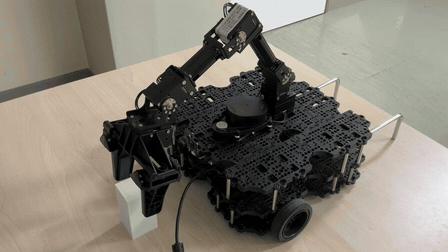

# ROS 2 실물 로봇 제어 · 지능로봇실습

**고정된 로봇 팔로 상자를 옮기고, 이동 로봇에는 목적지 두 곳을 차례로 보냈다.** ROS 2 Humble 수업에서 팔·그리퍼의 동작 순서와 Nav2의 목표 전송 로직을 작성하고, 실물 영상과 액션 로그를 대조했다.

[](mission4/results/mission4_202302200.mp4)

**11주차 · 상자 이송**　흰 상자가 그리퍼와 함께 움직이다가, B에서 그리퍼가 열린 뒤에는 세워진 자리에 그대로 남는다. 원본 영상의 0:30~2:00 구간을 12배속으로 재생했다.

강의의 관절 자세 예제를 바탕으로 5 × 5 × 10 cm 상자에 맞춰 네 관절의 목표각을 잡았다. 팔과 그리퍼가 각각 성공을 반환해야 다음 동작으로 넘어가게 했다. 실물 1회 실행에서 첫 개방 명령부터 초기 자세 복귀 완료까지 약 160초가 걸렸다. [팔·그리퍼 코드](mission4/src/ire_week11_moveit/scripts/pick_demo_202302200.py) · [원본 영상](mission4/results/mission4_202302200.mp4) · [실행 로그](mission4/results/run.log)

**10주차 · 두 지점 자율주행**　강의의 단일 목표 예제를 확장해 A의 성공 응답을 받은 뒤 B를 보내도록 했다. 경로 계획과 추종은 Nav2가 맡고, 작성한 Python 노드는 목표 순서와 취소, 결과 기록을 맡는다. 일반 주행과 장애물 주행을 각각 한 번 실행했고, 두 로그 모두 A와 B 순서로 `TaskResult.SUCCEEDED`를 기록했다. 장애물 주행 영상에는 로봇이 상자 옆을 돌아가는 장면이 보인다. [목표 전송 코드](mission3/src/ire_week10_nav_demo/ire_week10_nav_demo/go_to_pose_202302200.py) · [지도](mission3/results/maps/map.pgm) · [장애물 주행 영상](mission3/results/videos/a_obstacle_b.mp4) · [일반 로그](mission3/results/logs/no_obstacle_01.jsonl) · [장애물 로그](mission3/results/logs/with_obstacle_04.jsonl)

## 실습 목록

| 주차 | 구현·실습 | 관찰한 결과 |
| --- | --- | --- |
| [02 · 토픽 통신](week02/README.md) | 기본 talker·listener 데모를 실행하고 대응하는 Python 노드를 작성했다. | 기본 데모에서 발행한 `Hello World: 1`을 구독자가 같은 번호로 받았다. |
| [03 · Python 패키지](week03/README.md) | 노드·토픽 이름을 바꾸고 이름을 파라미터로 전달했다. | 발행·수신 로그에 같은 메시지가 찍히고 rqt_graph에 두 노드가 연결됐다. |
| [04 · 사각 순찰](mission1/README.md) | turtlesim의 위치와 방향으로 회전·전진을 제어하고 서비스로 정지·재개했다. | 두 바퀴를 돌았다. 직진·회전 중 각각 정지시킨 뒤 2초간 위치와 방향이 그대로였다. |
| [05 · 실물 bringup](mission2/README.md) | 팀원이 제공한 작업공간에 노트북을 연결해 바퀴와 팔을 조작했다. | 팀 캡처에 컨트롤러 5개가 `active`로 표시됐다. 주행 영상과 팔의 자세 사진을 남겼다. |
| [06 · Gazebo 주행](week06/README.md) | Gazebo·RViz·RQt Plot을 함께 실행하고 키보드 입력을 속도 명령으로 보냈다. | 시뮬레이션에서 직진·회전·정지할 때의 속도 명령과 센서 영상을 확인했다. |
| [07 · URDF와 TF](week07/README.md) | 링크 4개를 회전·직선·고정 관절로 연결했다. | 직선 관절을 약 0.137 m 움직인 상태에서 끝점의 TF 좌표는 (0.557, 0.000, 0.400) m였다. |
| [08 · ArUco 인식](week08/README.md) | 강의 검출기를 Pi 카메라에 연결하고 실시간 카메라 입력을 멈춘 뒤 rosbag을 재생했다. | 0.5배속 재생에서 영상 28개·보정 정보 32개를 받았고, ID 0과 자세 메시지 28개를 확인했다. |
| [09 · 실물 SLAM](week09/README.md) | 회전 구간에 벽이 겹쳐 보여 수동 주행 속도를 제한하고 지도를 저장했다. | 157 × 165셀 지도(0.05 m/셀)를 다시 불러왔다. 일부 벽 번짐과 미관측 영역이 남았다. |
| [10 · 두 지점 자율주행](mission3/README.md) | Nav2에 A와 B를 순서대로 보내고 목표별 결과를 기록했다. | 일반·장애물 주행에서 각각 두 목표의 성공 응답을 받았다. |
| [11 · 고정 베이스 상자 이송](mission4/README.md) | 교시한 자세를 이용해 접근부터 배치·후퇴까지 여섯 단계를 연결했다. | 상자를 세워 놓고 그리퍼가 물러난 뒤 팔이 초기 자세로 돌아왔다. |

[이동형 상자 이송 부록](appendix/mobile_pick_place/README.md)에는 베이스도 함께 움직인 별도 실물 실험의 코드·영상·기록이 있다. [코드 출처와 담당 범위](docs/PROVENANCE.md) · [실습별 검증 범위](docs/EVIDENCE.md)

## 실행 방법

Ubuntu 22.04에서 저장소를 내려받은 뒤, ROS나 로봇 없이 사각 순찰 제어기의 정지·재개 시험을 실행할 수 있다.

```bash
git clone https://github.com/ktw25079/Intelligent_Robot_Practice.git ~/intelligent_robot_practice
cd ~/intelligent_robot_practice
PYTHONPATH=mission1/mission1_202302200 \
  python3 -m unittest discover -s mission1/mission1_202302200/test -v
```

ROS 2 Humble 실습은 위 표에서 주차를 열고 해당 작업공간에서 빌드한다. 같은 이름의 패키지가 있어 주차별로 작업공간을 나눴다. [장치·통신 설정](docs/REPRODUCIBILITY.md) · [저장 자료 자동 검사](docs/EVIDENCE.md#자동-검사)
