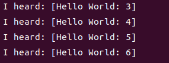
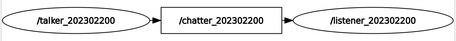
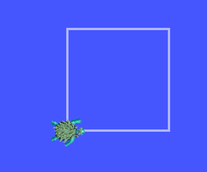
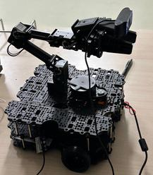
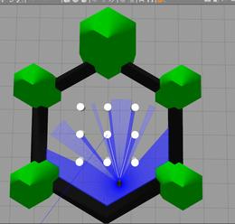
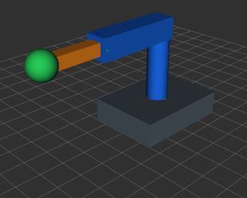
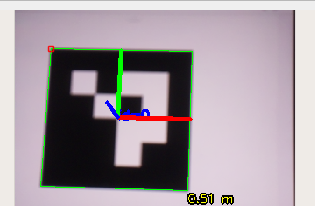
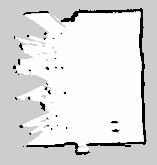
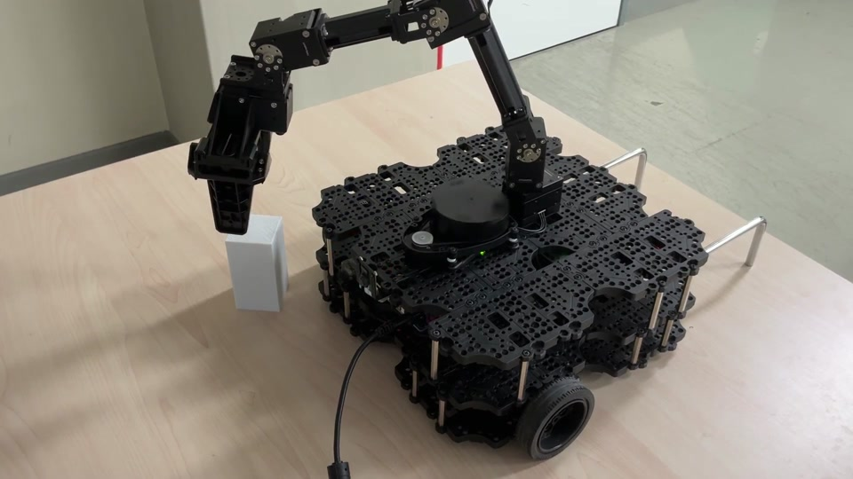

# 지능로봇실습

Ubuntu 22.04와 ROS 2 Humble에서 진행한 2~11주차 실습이다. 주차를 누르면 코드와 실행 방법, 결과 기록을 볼 수 있다.

| 주차 · 실습 | 구현과 결과 | 대표 장면 |
| --- | --- | :---: |
| [02 · 토픽 통신](week02/README.md) | 기본 데모에서 talker가 보낸 `Hello World: 3`을 listener가 같은 번호로 받았다. |  |
| [03 · Python 노드 연결](week03/README.md) | 발행자와 구독자를 패키지로 만들고 이름을 바꿨다. rqt_graph에 두 노드가 같은 토픽으로 연결됐다. |  |
| [04 · turtlesim 사각 순찰](mission1/README.md) | 서비스로 정지·재개한 뒤 사각형을 두 바퀴 돌았다. 두 차례의 정지 시험에서 각각 2초간 위치와 방향이 그대로였다. |  |
| [05 · TurtleBot3 실물 구동](mission2/README.md) | 팀 작업공간에 노트북을 연결해 바퀴와 팔을 조작했다. 컨트롤러 5개가 활성화됐다. |  |
| [06 · Gazebo 모의 주행](week06/README.md) | 키보드로 직진·회전·정지를 지시하고 RViz에서 센서 출력, RQt에서 속도 명령 변화를 확인했다. |  |
| [07 · URDF와 좌표 변환](week07/README.md) | 링크 4개를 회전·직선·고정 관절로 연결했다. 슬라이더를 움직여 RViz 형상과 끝점 좌표의 변화를 확인했다. |  |
| [08 · ArUco 마커 인식](week08/README.md) | 실시간 카메라 입력을 멈추고 rosbag을 재생하자 ID 0이 다시 검출되고 자세 메시지 28개가 수신됐다. |  |
| [09 · 실물 지도 작성](week09/README.md) | 저속으로 주행하며 만든 지도를 저장하고 다시 불러왔다. 지도는 157 × 165셀, 해상도는 0.05 m/셀이다. |  |
| [10 · Nav2 두 지점 주행](mission3/README.md) | 일반 주행과 장애물 주행에서 각각 A 도착 후 B를 보냈고, 두 목표 모두 성공 응답을 받았다. |  |
| [11 · 로봇 팔 상자 이송](mission4/README.md) | 베이스를 고정하고 팔과 그리퍼를 여섯 단계로 제어해 A의 상자를 B에 세워 놓았다. |  |

[이동형 상자 이송 부록](appendix/mobile_pick_place/README.md) · [실행 환경](docs/REPRODUCIBILITY.md) · [코드 출처와 담당 범위](docs/PROVENANCE.md)
