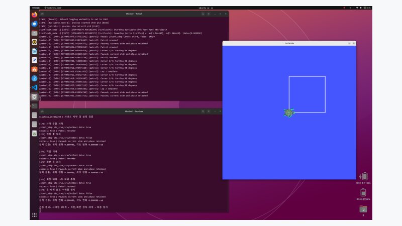
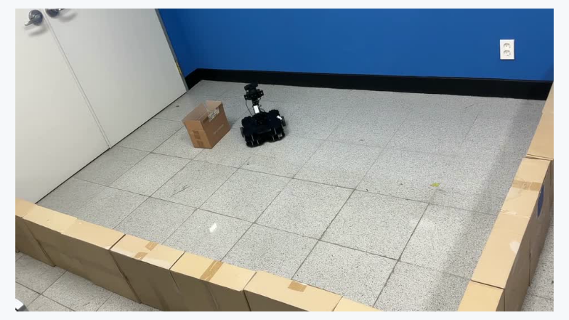
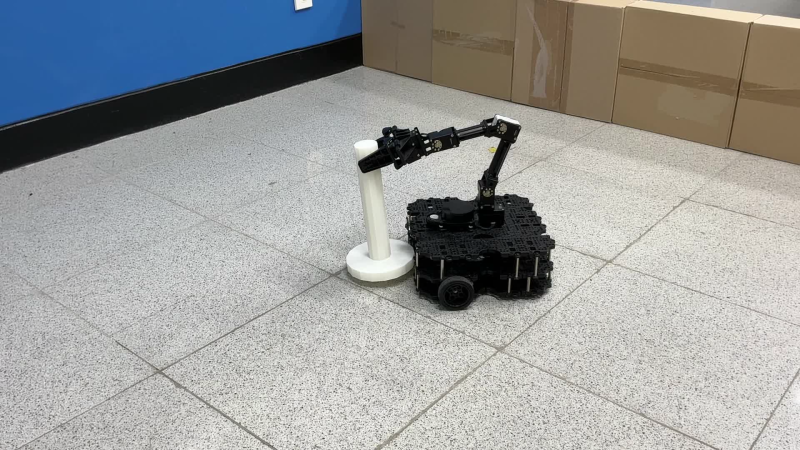
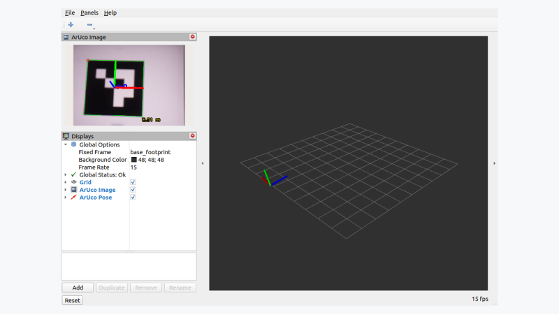

# Intelligent Robot Practice

**ROS 2 노드·서비스를 구현하고, 실물 TurtleBot3의 카메라·SLAM·Nav2·Pick & Place를 연결해 실행 결과를 검증한 프로젝트.**

강태욱 · 202302200 · 2026년 2학기 · Ubuntu 22.04 / ROS 2 Humble

[](https://github.com/ktw25079/Intelligent_Robot_Practice/actions/workflows/verify.yml)

[실습별 코드](#실습-목록) · [재현 안내](docs/REPRODUCIBILITY.md) · [검증 범위](docs/EVIDENCE.md) · [코드 출처와 기여](docs/PROVENANCE.md)

## 핵심 구현과 검증

직접 작성한 사각 순찰 제어기와 ROS 어댑터, 강의 예제를 확장한 Nav2 목표 관리 코드, 교시 궤적과 베이스 제어를 연결한 Pick & Place, 제공 패키지를 활용한 실물 통합 실습으로 구성된다. 팀 제공 드라이버와 강의 알고리즘의 적용 범위는 [코드 출처](docs/PROVENANCE.md)에 구분했다.

| 구현 판단 | 코드에서 확인할 부분 | 실행·검증 근거 |
| --- | --- | --- |
| 제어 로직과 ROS 통신 분리 | [상태 제어기](mission1/mission1_202302200/mission1_202302200/square_motion.py)와 [토픽·서비스 노드](mission1/mission1_202302200/mission1_202302200/patrol.py). 최초 방향 기준 회전, 정지 시 진행 상태 유지, 오래된 pose 입력 시 0속도 발행 | [수치 시험](mission1/mission1_202302200/test/test_square_motion.py)과 [두 바퀴·정지 측정값](mission1/results/patrol_demo_verification.json). turtlesim 결과 |
| 목표 전송 이후의 상태 관리 | [Nav2 클라이언트](mission3/src/ire_week10_nav_demo/ire_week10_nav_demo/go_to_pose_202302200.py). A 성공 후 B 전송, 목표 거절·시간 초과·odom 이상 처리, 취소 요청과 JSONL 기록 | [일반 주행](mission3/results/logs/no_obstacle_01.jsonl)·[장애물 주행](mission3/results/logs/with_obstacle_04.jsonl)의 A·B 성공, [실물·RViz 영상](mission3/README.md#결과) |
| 센서 입력과 재생 실험 분리 | [검출 노드](week08/ire_week08_vision/ire_week08_vision/aruco_detect.py)의 센서 QoS·영상 타임스탬프·광학 프레임 적용. 실시간 입력을 멈춘 뒤 bag 재생 | [수신·재생 기록](week08/results/verification.json): 영상 28개·CameraInfo 32개, 재생 pose 28개. 절대 위치 정확도는 미측정 |
| 증상에 따라 원인을 나누어 점검 | [카메라 케이블·모듈 비교](week08/docs/troubleshooting.md), [OpenCR·SDK 통신 점검](mission2/docs/hardware-repair.md), [매핑 속도 제한](week09/README.md) | 오류 로그·컨트롤러 상태·원본 지도 보존. 관찰과 원인 추정을 구분 |
| 단계별 조건에 따른 팔·베이스 연동 | [Mission 4 실행본](mission4/submission/pick_demo_202302200.py). 교시 궤적 액션 실행, LiDAR 지도 정합, 파지·높이 확인 후 이송·개방 | [run11 로그](mission4/results/continuous_run_11.log)의 6단계 완료·후퇴, [14개 시험](mission4/tests/). [실물 영상](mission4/README.md#실물-시연)에서 직립 배치·후퇴 확인 |

## 대표 결과

<table>
<tr>
<td width="50%" align="center" valign="top">
<a href="mission1/README.md"></a><br/>
<strong><a href="mission1/README.md">Mission 1 · 사각 순찰</a></strong><br/>
정지·재개와 두 바퀴 주행
</td>
<td width="50%" align="center" valign="top">
<a href="mission2/README.md"></a><br/>
<strong><a href="mission2/README.md">Mission 2 · 실물 제어</a></strong><br/>
컨트롤러 5개 활성화·팔 자세 변경
</td>
</tr>
<tr>
<td width="50%" align="center" valign="top">
<a href="mission3/README.md"></a><br/>
<strong><a href="mission3/README.md">Mission 3 · 자율주행</a></strong><br/>
A→B 순차 이동·장애물 회피 장면
</td>
<td width="50%" align="center" valign="top">
<a href="mission4/README.md"></a><br/>
<strong><a href="mission4/README.md">Mission 4 · 이동형 Pick & Place</a></strong><br/>
물체 이송·직립 배치·후퇴 시연
</td>
</tr>
<tr>
<td width="50%" align="center" valign="top">
<a href="week08/README.md"></a><br/>
<strong><a href="week08/README.md">week08 · 시각 인식</a></strong><br/>
ArUco ID·pose 검출과 기록·재생
</td>
<td width="50%" align="center" valign="top">
<a href="week09/README.md"></a><br/>
<strong><a href="week09/README.md">week09 · 지도 작성</a></strong><br/>
저속 매핑·지도 저장·재로드
</td>
</tr>
</table>

SLAM 지도에는 일부 미관측 영역과 번짐이 남아 있다. 각 실습에서 실행 근거와 확인 범위를 볼 수 있다.

## 실습 목록

| 실습 | 구현·적용한 내용 | 확인한 결과 | 실행 환경 |
| --- | --- | --- | --- |
| [week02](week02/README.md) | 기본 pub/sub 데모와 Python 대응 코드 | 같은 번호의 메시지 발행·수신 로그 | PC / ROS 데모 |
| [week03](week03/README.md) | Python 패키지·파라미터·remapping | 학번 노드·토픽, rqt_graph 연결 | PC / ROS 노드 |
| [Mission 1](mission1/README.md) | pose 기반 사각 순찰, SetBool 정지·재개 | 두 바퀴 시연, 직진·회전 정지 검사 | turtlesim |
| [Mission 2](mission2/README.md) | 팀 제공 ROBOTIS 작업공간 구성·실물 운용 | 컨트롤러 5개 active, 수동 주행·팔 자세 | Pi + TurtleBot3 |
| [week06](week06/README.md) | Gazebo·RViz·RQt 통합, 베이스 teleop | LaserScan·영상·속도 명령 그래프 | Gazebo |
| [week07](week07/README.md) | URDF 4링크·3종 관절, launch 설정 | 관절 슬라이더와 TF 변환·트리 | RViz / TF |
| [week08](week08/README.md) | 강의 ArUco 예제의 실물 적용·rosbag 검증 | CSI 카메라 ID·pose 재생, C920 ID 검출 | Pi 카메라 + PC |
| [week09](week09/README.md) | Cartographer 운용·저속 제한·저장 도구 | 157×165셀 지도, 0.05m/셀, 파일 재로드 | 실물 SLAM |
| [Mission 3](mission3/README.md) | Nav2 목표 전송·A→B 순차 주행·장애물 회피 | 실물 영상 2개, RViz 녹화, A·B 성공 로그 | 실물 Nav2 |
| [Mission 4](mission4/README.md) | MoveIt 기반 교시 궤적 검증·팔 액션·베이스 제어 통합 | 6단계 완료 로그·시연 영상, 직립 배치·후퇴 | 실물 이동형 Pick & Place |

week02의 저장 로그는 기본 데모 결과다. Mission 2는 팀 실습 자료이며, week08의 C920 보정·pose 재생과 week09의 전체 공간 폐루프 검증은 완료 확인 전이다. Mission 3의 성공 로그는 목표 도달 판정이며 반복 성공률·실측 도착 오차·전 구간 무충돌을 측정한 결과는 아니다. [근거와 한계 전체 보기](docs/EVIDENCE.md)

## 시작하기

```bash
git clone https://github.com/ktw25079/Intelligent_Robot_Practice.git ~/intelligent_robot_practice
cd ~/intelligent_robot_practice

# ROS·하드웨어 없이 저장소 자료와 제어기 수치 시험 확인
python3 tools/check_repository.py
PYTHONPATH=mission1/mission1_202302200 \
  python3 -m unittest discover -s mission1/mission1_202302200/test -v
```

동일 이름의 패키지가 있으므로 `colcon build`는 **각 실습 README에 지정된 작업공간**에서 실행한다. [장치·작업공간·통신 설정](docs/REPRODUCIBILITY.md)

CI는 문서·소스·데이터 검사, 사각 순찰 수치 시험과 Mission 4의 상태 전환·기록 검증을 실행한다. [자동 검사 항목](docs/EVIDENCE.md#자동-검사)

## 자료 구조와 출처

각 실습의 `README.md`는 **목표 → 과정 → 결과**, `screenshots/`는 화면·사진, `results/`는 로그·측정값·영상·지도다. Mission 2의 `workspaces/`는 팀 제공 소스다.

직접 작성한 제어기·URDF, 강의 예제 적용, ROBOTIS와 팀 제공 소스를 구분하고 원본 라이선스를 보존한다. [파일별 출처와 수정 범위](docs/PROVENANCE.md)
