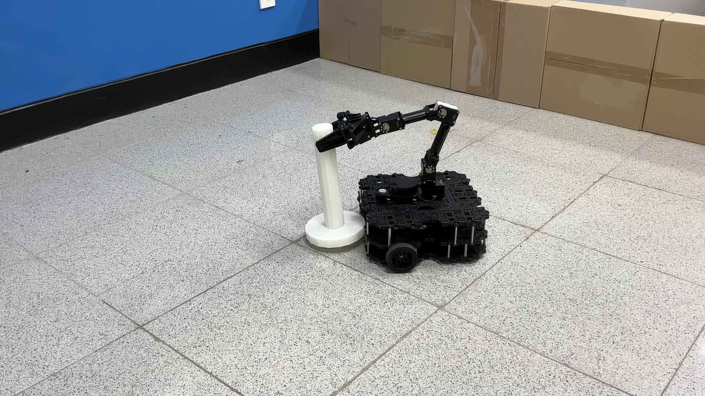
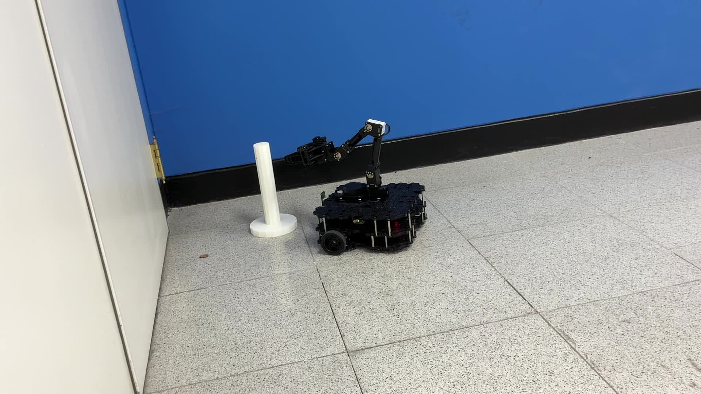

# 부록 · 이동형 Pick & Place

**교시한 팔 궤적과 베이스 제어를 연결하여 접근 → 하강 → 파지 → 상승 → 이송 → 배치·후퇴를 한 번의 실행으로 수행했다.** 2026-11-20 `continuous_run_11`에 6단계 완료가 기록되어 있다. 실물 영상에서는 물체 이송과 마지막 직립 배치·로봇 후퇴를 확인할 수 있다.

[시연 영상 · 4분 2초](https://github.com/ktw25079/Intelligent_Robot_Practice/releases/tag/mission4-demo-20261120) · [최종 실행 코드](submission/pick_demo_202302200.py) · [실행 로그](results/continuous_run_11.log) · [결과 요약](results/continuous_run_11_result.json) · [저장소 첫 화면](../../README.md)

강의 Lecture11 26–27쪽의 Mission 4는 **베이스 고정**이 조건이다. 이 자료는 베이스를 이동한 확장 실습이며 정지형 과제의 완료 증거로 사용하지 않는다. [정지형 Mission 4](../../mission4/README.md)는 별도로 구분한다.

## 목표

- 강의 `지능로봇실습_Lecture11_Moveit2.pdf` 26–27쪽의 교시 기반 6단계 Pick & Place를 자동 순서로 연결한다.
- 베이스가 정지한 강의 과제를 확장하여, 물체를 잡고 B 지점까지 이동한 뒤 개방·후퇴한다.
- 센서 상태와 각 단계의 완료 조건을 확인하고, 실패한 상태에서 다음 동작으로 넘어가지 않도록 구성한다.

## 과정

### 1. 교시·궤적 검증과 실행을 분리

RViz·수동 조작으로 접근·파지·상승 자세를 기록했다. [궤적 준비 코드](scripts/prepare_continuous_paths.py)는 관절 보간과 수치 IK로 저속 궤적을 만들고 MoveIt의 `/check_state_validity`로 로봇·바닥 충돌을, `/compute_fk`로 말단 운동학을 점검한다. 물체 접촉은 교시와 관찰에 의존하며, 잡은 물체의 전체 형상을 충돌 모델에 넣어 검증한 것은 아니다.

최종 실행은 저장한 궤적을 `FollowJointTrajectory`로 전달한다. 실행 중 MoveIt의 온라인 경로 계획을 호출하지 않는다. 베이스도 Nav2 대신 저장 지도·LiDAR 정합과 직접 작성한 `/cmd_vel` 제어를 사용한다. 강의의 정지형 과제와 이 이동형 확장의 범위를 구분한다.

| 구성 | 인터페이스·역할 |
| --- | --- |
| 팔·그리퍼 | `/arm_controller/follow_joint_trajectory`, `/gripper_controller/gripper_cmd` 액션 |
| 위치 추정 | `/odom`을 기준으로 `/scan`과 저장 지도를 정합하여 map–odom 기준 보정 |
| 베이스 | `/cmd_vel` 발행, 적재 중 선속도 최대 0.05m/s, 정지·재정합 후 제한된 횟수의 목표 보정 |
| 피드백 | `/joint_states`, `/dynamic_joint_states`로 관절·파지 변화·배터리 검사 |
| 상태 전환 | 접근·하강·파지·상승·이송·배치 순서, 실패 시 중단·액션 취소 요청·0속도 발행 |

### 2. 실패 원인에 맞춘 완료 조건

- **상승 목표 오차:** 하중이 있는 자세에서 제어기 허용오차를 넘는 경우가 있었다. `carry`의 특정 목표 오차 종료는 관찰로 확인한 관절값, 말단 위치·자세, 최소 상승량을 반복 확인한 경우에만 수용한다. 모든 액션 오류를 성공으로 바꾸지 않는다.
- **B 근처 전방 통로 검사:** 목표 근처에서 정지 후 지도 정합을 다시 수행한다. 위치 허용 범위 안이면 더 전진하지 않고 방향을 맞춘다. 오래된 센서 입력은 재시도 사유로 취급하지 않는다.
- **배치 후 개방:** 교시한 바닥 높이·자세 조건을 확인한 뒤 파지 유지 감시를 종료하고 그리퍼를 연다. 의도한 개방을 파지 이탈로 잘못 처리하지 않도록 순서를 나눴다.

이 조건은 실습 장비·물체에 맞춘 소프트웨어 검사다. 파지력 센서나 물체 자세 인식으로 물체의 안정성을 측정한 것은 아니다.

### 3. 파일과 실행

| 파일 | 용도 |
| --- | --- |
| [submission/pick_demo_202302200.py](submission/pick_demo_202302200.py) | 최종 독립 실행본. 기하 함수·Mission·run11 설정 포함 |
| [scripts/pick_demo_202302200.py](scripts/pick_demo_202302200.py), [mission_geometry.py](scripts/mission_geometry.py) | 같은 제어 로직의 모듈형 소스와 위치·운동학 계산 |
| [continuous_20261120.json](mission_config/continuous_20261120.json) | 최종 실행본에 내장된 설정과 동일한 지도·궤적·기준 좌표 |
| [교시 자세](taught_poses/), [궤적 준비 코드](scripts/prepare_continuous_paths.py) | 준비 단계 원본. 과거 설정의 검증 상태·출처 경로도 보존 |
| [시험](tests/) | ROS 없이 상태 전환·실패 처리·기하 계산·최종 번들 일치 확인 |
| [SHA256SUMS](SHA256SUMS) | 공개한 코드·설정·로그·사진의 해시. 11월 19일 설정의 지도·목표 출처는 당시 제출 폴더 기준 상대경로로 표기했다. `appendix/mobile_pick_place/`에서 `sha256sum -c SHA256SUMS` |

**PC에서 코드와 기록 확인:** 저장소 루트에서 실행한다. 로봇은 움직이지 않는다.

```bash
sudo apt-get install python3-numpy
python3 appendix/mobile_pick_place/submission/pick_demo_202302200.py
python3 -m unittest discover -s appendix/mobile_pick_place/tests -v
```

<details>
<summary>실물 실행 환경과 터미널별 명령</summary>

**실물 실행:** Ubuntu 22.04 / ROS 2 Humble, TurtleBot3 Manipulation의 Pi·OpenCR·팔·LiDAR를 사용한다. 드라이버 작업공간은 [Mission 2 환경 구성](../../mission2/docs/setup-and-run.md)에 따라 먼저 설치·빌드한다. 최종 코드는 독립 Python 파일이므로 별도 `colcon build`나 `ros2 run` 진입점이 필요 없다.

Pi의 첫 터미널에서 기존 하드웨어 overlay를 source한 뒤:

```bash
source /opt/ros/humble/setup.bash
source ~/turtlebot3_ws/install/setup.bash
export ROS_DOMAIN_ID=4 ROS_LOCALHOST_ONLY=0
ros2 launch turtlebot3_manipulation_bringup hardware.launch.py
```

Pi의 두 번째 터미널에서 같은 overlay를 source하고, 저장소 루트로 이동한 뒤:

```bash
source /opt/ros/humble/setup.bash
source ~/turtlebot3_ws/install/setup.bash
export ROS_DOMAIN_ID=4 ROS_LOCALHOST_ONLY=0
python3 appendix/mobile_pick_place/submission/pick_demo_202302200.py --execute
```

실제 작업공간 위치가 다르면 overlay 경로를 맞춘다. 실행본의 DDS 피어 설정은 domain 4의 로컬 컨트롤러를 대상으로 하므로 **Pi에서 실행**한다. Nav2·teleop 등 다른 속도 명령 발행은 중지한다. 시작 전 팔의 bringup 자세, 열린 그리퍼, 물체 재배치와 지도·odom 기준 좌표가 기록 조건과 맞아야 한다. 전원 재시작·수동 이동 후에는 기준 좌표와 교시를 다시 확인해야 한다. 설정 교체는 `--config <설정.json>`으로 한다.

PC의 MoveIt/RViz는 교시·준비 단계에서 `ros2 launch turtlebot3_manipulation_moveit_config moveit_core.launch.py`로 사용했다. 궤적 준비 스크립트는 ROS·MoveIt 서비스와 `python3-scipy`가 필요한 과거 준비 절차이며, 실행하면 궤적 파일을 다시 생성한다. 최종 시연 재생에는 호출하지 않는다.

</details>

## 결과

### 실물 시연

[**전체 영상 보기·다운로드 (MP4, 720p)**](https://github.com/ktw25079/Intelligent_Robot_Practice/releases/download/mission4-demo-20261120/mission4-demo-720p.mp4) · [영상 페이지](https://github.com/ktw25079/Intelligent_Robot_Practice/releases/tag/mission4-demo-20261120) · [출처·해시·확인 범위](results/video_evidence.json)

<table>
<tr>
<td width="50%" align="center"><a href="https://github.com/ktw25079/Intelligent_Robot_Practice/releases/tag/mission4-demo-20261120"></a><br/><strong>02:20 · 물체 이송</strong></td>
<td width="50%" align="center"><a href="https://github.com/ktw25079/Intelligent_Robot_Practice/releases/tag/mission4-demo-20261120"></a><br/><strong>03:58 · 직립 배치 후 후퇴</strong></td>
</tr>
</table>

`IMG_0274.mov`의 전체 241.533초를 실시간 속도·음성 그대로 MP4로 변환했다. 원본 MOV는 로컬에 보존하고, 보기용 사본은 1280×720 / 30fps로 제공한다. 마지막 장면에서 물체가 세워진 채 남고 그리퍼가 떨어진 뒤 로봇·팔이 물러난 모습을 확인했다.

| 영상 탐색 위치 | 확인할 장면 |
| --- | --- |
| 00:00–01:15 | 베이스 접근과 팔 자세 변경 |
| 01:15–02:00 | 하강·파지·상승 구간 |
| 02:00–03:15 | 물체를 잡은 상태로 목적지 방향 이동 |
| 03:15–04:01 | 배치·개방·베이스 후퇴와 팔 복귀 |

구간은 영상 탐색용 근사값이다. 촬영 메타데이터는 run11과 같은 날짜를 가리키지만 영상과 로그의 프레임 단위 시각 동기화는 검증하지 않았다. 영상으로 파지력이나 물체와 바닥 사이의 정확한 간격을 측정하지 않는다.

### 실행 로그와 수치

[run11 원본 로그](results/continuous_run_11.log)의 `mission_start`부터 `six_stage_complete`까지 약 **238.9초**다. [당시 결과 기록](results/continuous_run_11_result.json)은 한 번의 실행·수동 개입 없음으로 기록되어 있으며, 로그에는 6단계와 최종 `completed: true`가 남아 있다.

| 확인 항목 | 기록값·판정 | 해석 범위 |
| --- | --- | --- |
| 6단계 연속 실행 | 접근 → 하강 → 파지 → 상승 → 이송 → 배치·후퇴 완료 | 단일 실행 기록. 반복 성공률은 미측정 |
| 상승 | 말단 높이 증가 0.02716m | 관절 피드백 기반 FK 계산. 물체 바닥 간격의 실측 아님 |
| B 도착 | 목표 대비 평면 거리 0.04126m | 지도·odom 기반 추정값. 외부 실측 오차 아님 |
| 배치·개방 | 배치 자세 확인 후 그리퍼 위치 0.01901m | 영상 마지막 구간에서 직립 배치와 그리퍼 분리 확인 |
| 후퇴·복귀 | 후퇴 0.09864m, 팔 bringup 자세 복귀 | 후퇴는 odom 기반 거리 |
| 배터리 | 시작 12.24V → 종료 12.13V | 해당 실행의 피드백 값 |

파지 액션은 `status: 6` 종료 후 교시 접촉 위치 조건으로 수용했고, 상승도 `controller_status: 6` 후 `observed_endpoint_accepted`로 진행했다. 따라서 이 결과를 모든 액션의 정상 성공 응답으로 해석하지 않는다. B 접근 중에는 두 번의 근접 재정합 기록이 있다.

#### 단계별 경과 시간

| 완료 구간 | 시간 (s) | 종료 이벤트 |
| --- | ---: | --- |
| 접근·정렬·팔 접근 자세 | 69.58 | `arm_complete: approach` |
| 하강·바닥 기준 확인 | 22.22 | `floor_reference` |
| 파지 | 2.73 | `gripper_complete` |
| 상승·높이 확인 | 22.34 | `lift_verified` |
| B 이송·위치 재정합·정렬 | 71.98 | `navigation_complete` |
| 배치·개방·후퇴·팔 복귀 | 50.01 | `six_stage_complete` |

첫 구간은 `mission_start`부터, 이후 구간은 직전 완료 이벤트부터 계산하여 대기·상태 전환 시간도 포함한다. 이 실행에서는 이송 구간이 가장 길었고, 근접 재정합 2회가 포함됐다. 구간 시간만으로 재정합 자체의 비용이나 수정 전후 개선량을 분리하지 않는다. [구간 경계·원본 해시](results/run11_timing.json)

저장소 루트에서 `python3 tools/summarize_saved_runs.py --check`를 실행하면 Mission 3·4의 시간 요약이 원본 로그와 일치하는지 확인한다. 로봇이나 ROS를 실행하지 않는다.


<details>
<summary>이전 파지 시험 자료</summary>

[초기 부분 파지·상승 사진](screenshots/early-grasp.png)은 당시 원본으로 보존한다. 위 최종 시연 캡처와 다른 시험이며, run11의 전체 동작 근거로 사용하지 않는다.

</details>

### 검증 범위

기존 11개 시험은 당시 `continuous_mission.json`을 사용한 상태 전환·회귀 시험이다. 추가 시험은 최종 실행본과 모듈형 코드의 일치, 내장 설정과 최종 JSON의 일치, run11 단계·수치의 연결을 확인한다. ROS 통신이나 실물 동작을 새로 실행한 검증은 아니다. 설정 원본의 `execution_verified` 등 과거 플래그는 보존했으며, 최종 실행 근거는 별도의 run11 로그로 구분한다. 당시 결과 JSON의 영상 확인 대기 문구도 원본 그대로 두고, 이후 확인한 시연 장면은 [영상 확인 기록](results/video_evidence.json)에 별도로 남겼다.
