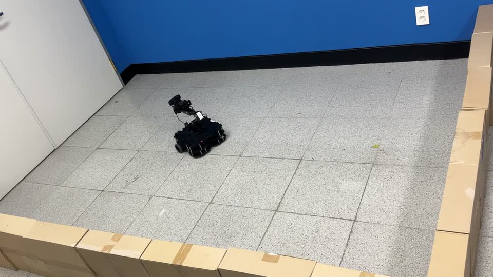
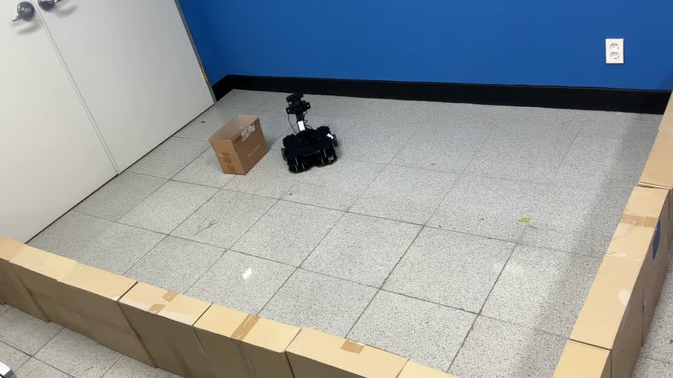
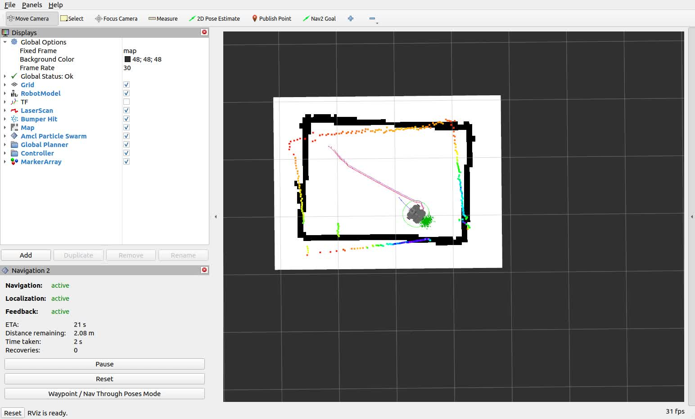

# Mission 3 · Nav2 두 지점 자율주행

[전체 실습](../README.md) · [재현 환경](../docs/REPRODUCIBILITY.md) · [검증 근거](../docs/EVIDENCE.md) · [실행 코드](src/ire_week10_nav_demo/ire_week10_nav_demo/go_to_pose_202302200.py)

직접 만든 실물 지도에서 Nav2로 A→B 순차 주행과 장애물이 있는 경로의 회피를 실습했다. 실물 영상 2개, RViz 녹화, 목표별 결과 로그를 함께 보관한다.

## 목표

- 코드로 A 도착을 확인한 뒤 B로 이동한다.
- 장애물에 따른 경로 변화와 도착 결과를 확인한다.
- 강의자료 `지능로봇실습_Lecture10_Nav2.pdf` 21–22쪽의 미션 3 기준인 순차 도착·충돌 없는 주행·장애물 재계획을 실행 자료와 대조한다.

## 과정

### 1. 측위·계획·제어

Ubuntu 22.04 / ROS 2 Humble과 실물 TurtleBot3 Manipulation을 사용했다. AMCL은 저장 지도와 LiDAR 스캔으로 위치를 추정하고, planner는 global costmap에서 경로를 계산하며, controller는 local costmap을 이용해 속도 명령을 만든다. 장애물 주변의 inflation 비용은 경로의 여유 거리에 영향을 준다. Behavior Tree는 경로 계산·추종·복구를 연결한다.

[Nav2 설정](config/nav2.yaml)과 [실물 컨트롤러 설정](config/hardware_controller_manager.yaml), [지도](results/maps/map.yaml)를 보관했다. 실물 odometry는 `open_loop=false`, `position_feedback=true`인 엔코더 피드백을 사용한다. 지도는 이번 주행에 사용한 저장본이며 week09의 지도와 구분한다.

### 2. 목표 전송 코드

[go_to_pose_202302200.py](src/ire_week10_nav_demo/ire_week10_nav_demo/go_to_pose_202302200.py)는 강의의 단일 목표 예제를 두 지점 순차 실행으로 확장했다. `map` 좌표계의 x·y와 yaw를 `PoseStamped`로 만들고, yaw는 `sin(yaw/2)`, `cos(yaw/2)`로 변환한다.

```python
for name in ('A', 'B'):
    # 목표를 전송하고 완료 후 결과를 검사하는 핵심 흐름
    nav.goToPose(pose(config[name]))
    while not nav.isTaskComplete():
        feedback = nav.getFeedback()
    if nav.getResult() != TaskResult.SUCCEEDED:
        raise RuntimeError(f'{name} did not succeed; no next goal sent')
```

위 코드는 흐름 요약이다. 실제 소스는 목표 거절·180초 제한·오도메트리 단절을 검사하며 예외 시 실행 중인 작업을 취소한다. `/plan` 경로, 남은 거리, 복구 횟수와 결과를 JSONL로 저장한다. `--execute`가 없으면 A→B 경로 생성만 확인한다.

| 실행 설정 | A (x, y, yaw) | B (x, y, yaw) |
| --- | --- | --- |
| [일반 주행](config/no_obstacle_01_goals.json) | (0.056, 0.228, 1.027) | (1.206, 2.128, 1.027) |
| [장애물 주행](config/with_obstacle_04_goals.json) | (-0.101, 0.463, 0.805) | (1.206, 2.128, 1.027) |

위치는 m, 방향은 rad이다. 장애물 주행의 A는 복귀 후 정렬한 실제 출발 위치를 반영했다.

<details>
<summary>설치·빌드·실행 방법</summary>

### 3. 빌드와 실행

사전 조건은 ROS 2 Humble, `colcon`, 실물 bringup 및 TurtleBot3 로봇 모델이다. 하드웨어 준비는 [Mission 2](../mission2/docs/setup-and-run.md)를 따른다. 저장소의 `mission3/`에서 별도 작업공간으로 빌드한다. 아래 복사는 `~/nav10_ws/src`에 두 패키지가 없는 최초 배치 기준이다. 기존 작업공간에서는 중복 복사하지 않는다.

```bash
source /opt/ros/humble/setup.bash
sudo apt install python3-colcon-common-extensions ros-humble-navigation2 \
  ros-humble-nav2-bringup ros-humble-nav2-simple-commander
export NAV_DATA="$PWD"  # 현재 위치: 저장소/mission3
mkdir -p ~/nav10_ws/src
cp -r "$NAV_DATA/src/ire_week10_nav_demo" "$NAV_DATA/src/turtlebot3_manipulation_navigation2" ~/nav10_ws/src/
cd ~/nav10_ws
colcon build --symlink-install
```

**로봇 SBC 터미널:** 기존 하드웨어 작업공간을 source하고 동일한 통신 설정으로 실행한다. 컨트롤러 설정의 엔코더 피드백 값이 보관본과 일치하는지 확인한다.

```bash
source /opt/ros/humble/setup.bash
source ~/turtlebot3_ws/install/setup.bash
source ~/lecture05-repair_ws/install/setup.bash  # Mission 2 하드웨어·SDK 보정본
export ROS_DOMAIN_ID=4 ROS_LOCALHOST_ONLY=0
ros2 launch turtlebot3_manipulation_bringup hardware.launch.py
```

**PC 터미널 1·2 공통:** 각 터미널에서 저장소 `mission3/`로 이동하고 실행한다. 로봇 모델이 별도 overlay에 있으면 먼저 source한다.

```bash
source /opt/ros/humble/setup.bash
source ~/nav10_ws/install/setup.bash
export ROS_DOMAIN_ID=4 ROS_LOCALHOST_ONLY=0
export NAV_DATA="$PWD"
```

**PC 터미널 1:** Cartographer·teleop을 종료하고 저장 지도와 Nav2 설정을 불러온다. 실물에서는 시뮬레이션 시간을 사용하지 않는다.

```bash
ros2 launch turtlebot3_manipulation_navigation2 navigation2.launch.py \
  map_yaml_file:="$NAV_DATA/results/maps/map.yaml" \
  params_file:="$NAV_DATA/config/nav2.yaml"
```

RViz의 `2D Pose Estimate`로 실제 위치·방향을 지정하고 지도와 스캔의 정렬을 확인한다. A·B를 새로 정할 때는 `Publish Point`와 `/clicked_point`로 지도 좌표를 확인한다.

**PC 터미널 2:** 먼저 경로만 확인한 뒤 실제 주행한다. 로그는 기존 파일을 덮어쓰지 않으므로 매번 새 이름을 사용한다.

```bash
ros2 run ire_week10_nav_demo go_to_pose_202302200 \
  --goals "$NAV_DATA/config/no_obstacle_01_goals.json" \
  --log "/tmp/nav10_plan_$(date +%s).jsonl"

ros2 run ire_week10_nav_demo go_to_pose_202302200 \
  --goals "$NAV_DATA/config/no_obstacle_01_goals.json" \
  --log "/tmp/nav10_run_$(date +%s).jsonl" --execute
```

장애물 실습은 `with_obstacle_04_goals.json`을 사용한다. 강의 조건은 주행 중 로봇보다 1 m 이상 앞에 LiDAR 높이에 걸리는 장애물을 놓고 경로 변화를 확인하는 것이다. 저장 좌표는 제공 지도 전용이며 다른 공간에서는 다시 지정한다.

</details>

## 결과

| 구분 | 실물 영상 | RViz 녹화 | 실행 로그 |
| --- | --- | --- | --- |
| 일반 A→B | [31.248초 MP4](results/videos/a_to_b.mp4) | [47.534초 MKV](results/videos/rviz_no_obstacle_01.mkv) | [no_obstacle_01](results/logs/no_obstacle_01.jsonl) |
| 장애물 경유 A→B | [15.682초 MP4](results/videos/a_obstacle_b.mp4) | [39.734초 MKV](results/videos/rviz_with_obstacle_04.mkv) | [with_obstacle_04](results/logs/with_obstacle_04.jsonl) |

두 로그 모두 A와 B에 대해 `TaskResult.SUCCEEDED`, 마지막에 `sequence_succeeded`를 기록했다. 실물 영상에서는 일반 이동과 상자가 있는 구간을 돌아가는 이동을 확인할 수 있다.

| 일반 주행 · 20초 | 장애물 구간 · 6초 |
| --- | --- |
|  |  |



RViz 장애물 녹화의 20초 장면에는 지도 내부의 센서 반사점과 굽은 경로가 보이며 이후 목표 부근으로 이동한다. 원본 영상에서 시간에 따른 경로 변화를 확인할 수 있다.

실물 영상은 장애물을 놓는 순간을 포함하지 않으며, 실물 영상과 RViz·로그의 정확한 시각 동기화는 확인하지 않았다. 따라서 로그의 도착 성공과 촬영 구간의 회피 장면을 근거로 기록하고, 전 주행 충돌 0회 및 주행 중 장애물 투입 조건 전체를 검증한 것으로 단정하지 않는다. [원본 파일명·SHA-256·캡처 시각](results/video_sources.json)을 함께 보관했다.

소스 출처: iCIRLab `icir_ire_lecture`의 Nav2 예제와 ROBOTIS `turtlebot3_manipulation_navigation2`(Apache-2.0). 원본 패키지 구조와 저작권 헤더를 유지한다. [코드 출처와 적용 범위](../docs/PROVENANCE.md)를 참고한다.
