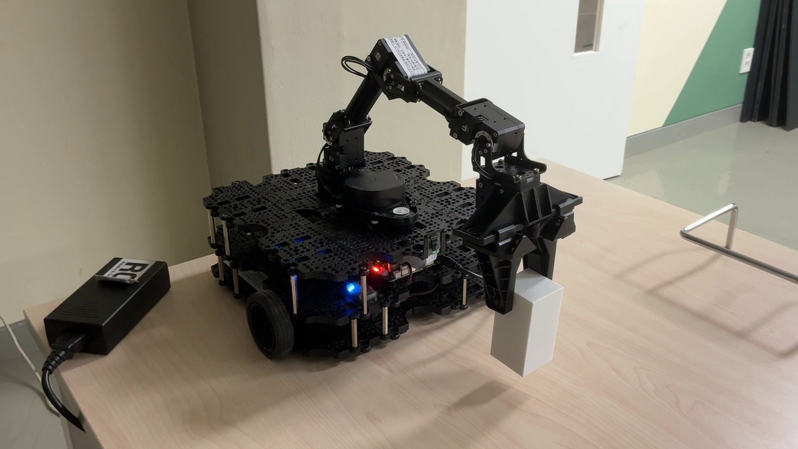
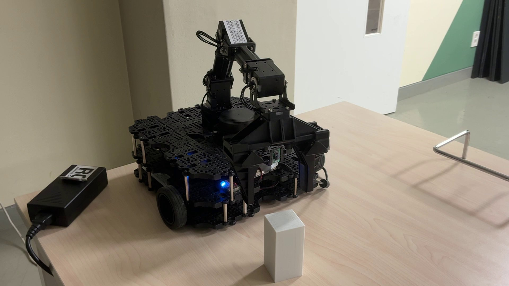
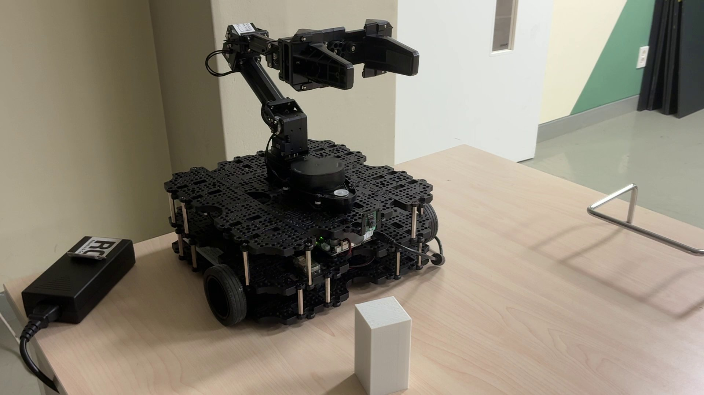

# Mission 4 · 정지형 Pick & Place

## 목표

Lecture11 22·26–27쪽에 따라 베이스를 고정하고 A의 상자를 B로 옮긴다. 코드 한 번으로 6단계를 실행하고, 이송 중 낙하 없이 B에 세워 놓은 뒤 그리퍼를 후퇴시킨다.

## 과정

[실행 코드](src/ire_week11_moveit/scripts/pick_demo_202302200.py)는 관절 피드백에서 수직 경로의 수치 IK를 계산하고 MoveIt 상태 유효성 검사 및 물체·탁자 충돌 검사를 거쳐 액션으로 실행한다. 5×5×10cm 물체를 재교시한 A에서 집고 베이스 관절을 오른쪽20° 회전한 B에 놓는다.

접근 → 저속 하강 → 파지 → 수직 상승 → 높이를 유지한 회전 이송 → 하강·개방·상승후퇴 순서이다. 개방 직후 먼저 위로 분리하고 손목 자세를 바꾼 뒤 초기 자세로 복귀한다. Pi 내부 실행과 피드백 전용 스레드로 무선·계산 지연 영향을 줄였다.

```bash
# 환경 구성·전용 워크스페이스 빌드는 RUNNING.md 참고
source ~/mission4_recording_ws/install/setup.bash
ros2 run ire_week11_moveit pick_demo_202302200           # 연결 상태와 경로 검사
ros2 run ire_week11_moveit pick_demo_202302200 --execute # 실물 실행
```

[환경·빌드·실행 절차](RUNNING.md). 다른 장비나 배치에서는 재교시해야 하며 AI용 conda 환경과 ROS 시스템 Python을 섞지 않는다.

## 결과

[실물 시연 영상 및 재현 자료](https://github.com/ktw25079/Intelligent_Robot_Practice/releases/tag/mission4-stationary-20261125)

| 확인 항목 | 결과와 근거 |
| --- | --- |
| 단일 실행6단계 | [실행 로그](results/execution.jsonl)와 [단계별 결과](results/execution.json), 전 과정 영상 일치 |
| 무낙하 파지·이송 | 약01:35 상승 후 탁자와 분리, 01:53~02:08 이송 중 유지 |
| B 직립 배치·상승후퇴 | 약02:09 이후 배치·개방, 위로 분리하여 후퇴, 마지막04:43까지 직립 |
| 베이스 고정 | 영상과 실행 중 바퀴 상태 감시로 확인 |


01:45 — 물체가 탁자에서 떠 있는 상태.


03:01 — B에 직립한 물체와 위로 분리된 그리퍼.


04:43 — 물체를 B에 남기고 초기 자세 복귀.

강의 필수3조건을 충족한 것으로 판단했다. 영상은 전체 시간대3초 간격, 파지~배치 구간1초 간격 확대 확인과 실행 로그로 대조했으며 공식 채점 결과는 아니다. [전체27쪽 검토 기록](results/lecture11_pages.csv).

실제 상승은 FK상 약2.94cm로 목표5cm와 차이가 있다. 상승·후퇴 일부 액션은 목표오차(-5)를 반환했으며 실제 진행과 충돌 여유를 검사한 경우에만 같은 실행에서 이어갔다. 제어오차 자체가 해결된 것은 아니며 최종 구성의 반복 성공률과 Gazebo 전 과정은 측정·검증하지 않았다. 원본 로그의 physical_success_confirmed=false는 영상 검토 전 자동 기록이다.

이전 이동형 구현과 증거는 [부록](../appendix/mobile_pick_place/README.md)에 보존한다.
