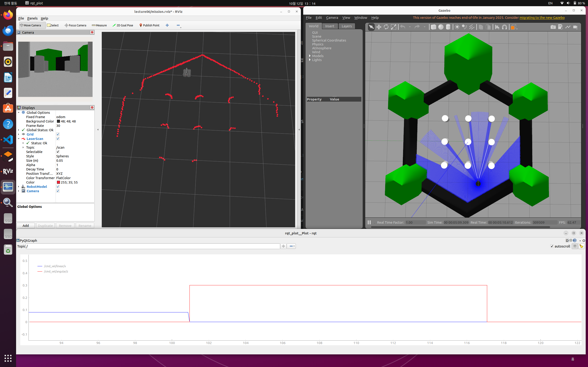

# week06 실습 정리

## 목표

- Gazebo에서 Waffle Pi + OpenMANIPULATOR-X를 생성하고 키보드로 베이스를 주행한다.
- RViz2로 LaserScan·로봇 모델·카메라 영상을 확인하고 RQt Plot으로 속도 명령을 관찰한다.
- 세 도구의 동작 화면을 캡처 한 장에 기록한다.

## 과정

### 1. 통합 launch와 키보드 제어

[mission.launch.py](mission.launch.py)는 공식 `turtlebot3_manipulation_gazebo/gazebo.launch.py`를 포함하여 시뮬레이터를 실행한다. 12초 뒤 RViz2와 RQt Plot을 실행한다. 이 지연은 초기 구동 대기이며 센서 준비 완료를 검사하는 로직은 아니다.

[mission.rviz](mission.rviz)는 Fixed Frame을 `odom`, LaserScan을 `/scan`, 점 크기를 0.05m로 설정한다. RobotModel은 `/robot_description`, 카메라는 실제 발행 토픽인 `/pi_camera/image_raw`을 사용한다. RViz2에는 `use_sim_time=true`를 적용한다.

[teleop.py](teleop.py)는 `/cmd_vel`에 `geometry_msgs/msg/Twist`를 발행한다. 강의의 베이스 키 배치인 `i/k`(선속도 ±0.01m/s), `j/l`(각속도 ±0.1rad/s), Space(정지), Esc(종료)를 사용하며 최대 선속도는 ±0.2m/s, 최대 각속도는 ±0.5rad/s이다. 마지막 명령을 유지하므로 이동 후 Space로 정지한다. 팔 키보드 조작과 MoveIt Servo는 이번 실행에 포함하지 않았다.

### 2. 패키지 준비와 최초 빌드

Ubuntu 22.04 및 ROS 2 Humble이 설치된 PC 기준이다. 최초 한 번 수행하며, 기존 작업공간이 있으면 새로 복제하지 않고 경로를 맞춘다.

```bash
sudo apt update
sudo apt install -y git python3-colcon-common-extensions \
  gazebo ros-humble-gazebo-ros-pkgs ros-humble-gazebo-ros2-control \
  ros-humble-ros2-controllers ros-humble-xacro \
  ros-humble-robot-state-publisher ros-humble-rviz2 \
  ros-humble-rqt-plot ros-humble-rqt-topic python3-pyqtgraph
mkdir -p "$HOME/tb3_sim_ws/src"
cd "$HOME/tb3_sim_ws/src"
git clone --branch humble https://github.com/ROBOTIS-GIT/turtlebot3_simulations.git
git -C turtlebot3_simulations checkout a35a56c8b04877dc89772b598084d8ce648a9023
source /opt/ros/humble/setup.bash
cd "$HOME/tb3_sim_ws"
colcon build --symlink-install \
  --packages-select turtlebot3_gazebo turtlebot3_manipulation_gazebo
```

시뮬레이션 전용 패키지에는 팔을 포함한 URDF와 mesh가 들어 있다. 이 베이스 주행에는 실물 하드웨어 패키지나 MoveIt Servo 빌드가 필요하지 않다. 캡처 당시에는 동일한 소스의 리소스를 등록하고 Gazebo 의존성을 작업 폴더에서 로드했다. 위 명령은 일반 apt 설치 환경에서의 재현 절차다.

### 3. 실행과 시각화

아래는 저장소 루트에서 실행한다. 다른 작업공간을 사용하면 각 터미널에서 `TB3_SIM_WS`를 지정한다. [env.sh](env.sh)는 ROS·Gazebo 경로와 `ROS_DOMAIN_ID=66`, `ROS_LOCALHOST_ONLY=1`, Gazebo 포트 11366을 설정한다.

**터미널 1 — 시뮬레이션·RViz2·Plot:**

```bash
bash week06/run.sh
```

[run.sh](run.sh)의 핵심 명령은 `ros2 launch ./mission.launch.py`이다. Plot은 `/cmd_vel/linear/x`와 `/cmd_vel/angular/z`를 표시한다. Plot 표시 범위를 약 30초, 세로축을 -0.15~0.55로 조정하면 낮은 속도 변화도 읽기 쉽다.

**터미널 2 — 키보드 주행:**

```bash
source week06/env.sh
python3 week06/teleop.py
```

**터미널 3 — 토픽 확인:**

```bash
source week06/env.sh
ros2 topic info /scan
ros2 topic echo /odom --once
ros2 service call /controller_manager/list_controllers \
  controller_manager_msgs/srv/ListControllers '{}'
ros2 run rqt_topic rqt_topic
```

Topic Monitor에서 `/odom`, `/cmd_vel`을 선택한다. 현재 RQt Plot 버전은 Odometry의 header에는 시뮬레이션 시각, header가 없는 Twist에는 PC 시각을 사용하므로 두 메시지를 한 시간축에 혼합하지 않았다.

## 결과

Gazebo 로봇 생성, LaserScan 표시, 카메라 영상, 키보드 직진·회전·정지와 속도 명령 그래프를 확인했다. 왼쪽은 RViz2, 오른쪽은 Gazebo, 아래는 RQt Plot이다.



주행 후 로봇 자세가 불안정해져 월드를 초기 위치로 복원했다. 캡처의 로봇은 정지 상태이고, Plot에는 복원 전 실제 속도 명령 기록을 일시정지해 보존했다. 그래프는 명령값이며, 실제 속도의 추종 오차를 측정한 결과는 아니다.

- [로봇 생성 로그](results/spawn.log) · [Gazebo 원본 로그](results/gazebo.log)
- [컨트롤러 4개 active 확인](results/controllers.txt) · [LaserScan 토픽 확인](results/scan-info.txt)
- [실행 환경·관찰 범위·로그 해석](results/observations.md)

Topic Monitor의 `/odom` 수신 주기, 팔 키보드 조작, 사각 경로 도전 과제와 실물 동작은 검증하지 않았다.
