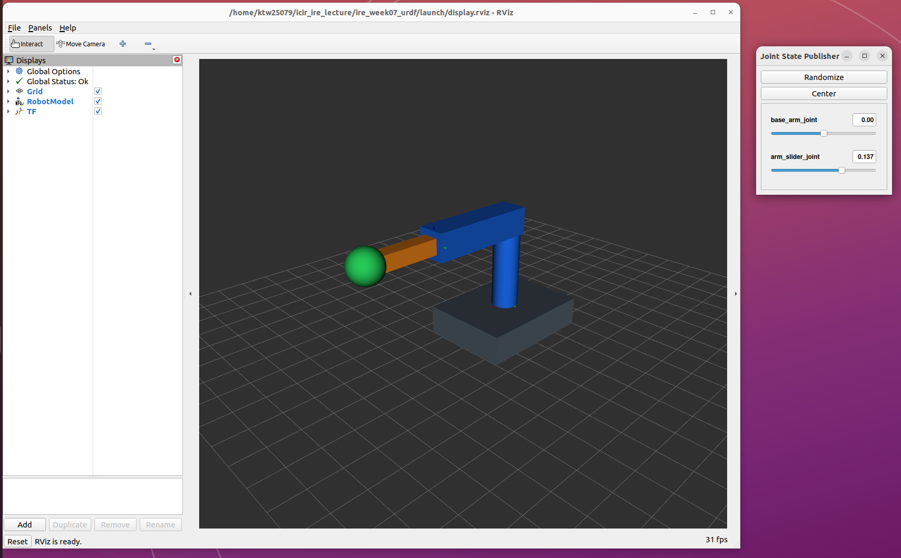

# week07 실습 정리

## 목표

- `base_link`를 첫 링크로 하는 URDF를 직접 설계하고, 링크 3개 이상·관절 2종류 이상을 구성한다.
- RViz와 관절 슬라이더로 모델을 표시하고 회전·직선 이동을 확인한다.
- `tf2_echo`로 링크 사이 변환을 읽고 `view_frames`로 TF 트리를 추출한다.

## 과정

### 1. 로봇 설계와 URDF 작성

[myurdf_202302200.urdf](myurdf_202302200.urdf)는 회색 받침대, 파란 회전 팔, 주황색 신축 막대, 초록색 끝점으로 구성한 새 모델이다. 기존 강의 예제의 몸통·목·머리 모델과 다른 구조이며, 링크 4개와 관절 3종류를 사용한다.

| 부모 → 자식 | 관절 이름·종류 | 운동 범위 |
| --- | --- | --- |
| `base_link` → `arm_link` | `base_arm_joint` · revolute | Z축 회전, -1.5708~1.5708rad |
| `arm_link` → `slider_link` | `arm_slider_joint` · prismatic | 팔의 로컬 X축 이동, 0~0.20m |
| `slider_link` → `tool_link` | `slider_tool_joint` · fixed | 끝점 고정 |

`visual`의 기본 도형과 색으로 각 링크를 구분하고, `origin`으로 연결 위치를 지정했다. `parent`·`child`로 트리를 구성하고 `axis`·`limit`으로 관절의 축과 범위를 정했다. RViz/TF 확인용 모델이므로 동역학 시뮬레이션에 필요한 질량·관성·충돌 형상은 포함하지 않았다.

### 2. 준비와 검사

Ubuntu 22.04와 ROS 2 Humble이 설치된 PC에서 저장소 루트 기준으로 실행한다. 별도의 ROS 패키지 빌드는 필요 없다.

```bash
sudo apt update
sudo apt install -y liburdfdom-tools ros-humble-robot-state-publisher \
  ros-humble-joint-state-publisher-gui ros-humble-rviz2 \
  ros-humble-tf2-ros ros-humble-tf2-tools graphviz
source /opt/ros/humble/setup.bash
cd week07
check_urdf myurdf_202302200.urdf
```

실습 PC에서는 관절 GUI 패키지가 없어 공식 ROS Debian 패키지를 로컬 경로에 풀어 실행했다. 위 명령은 일반 apt 설치 환경의 재현 절차이며, 설치 라이브러리는 저장소에 포함하지 않는다.

### 3. RViz와 슬라이더 실행

**터미널 1 — `week07/`에서 실행:**

```bash
source /opt/ros/humble/setup.bash
ros2 launch ./launch/display.launch.py model:="$(pwd)/myurdf_202302200.urdf"
```

[display.launch.py](launch/display.launch.py)는 강의 launch를 바탕으로 `model` 절대경로 인자와 RViz 설정 파일을 받도록 수정했다. `robot_state_publisher`, `joint_state_publisher_gui`, `rviz2`를 실행한다. 저장소용 기본 모델 경로는 이 폴더의 URDF로 지정했다.

[display.rviz](launch/display.rviz)는 Fixed Frame을 `base_link`로 설정하고 `/robot_description`의 RobotModel과 TF를 표시한다. `base_arm_joint` 슬라이더는 팔 전체를 회전시키고, `arm_slider_joint`는 주황 막대와 초록 끝점을 팔 방향으로 이동시킨다. fixed 관절은 슬라이더가 없다.

### 4. TF 변환과 트리 확인

**터미널 2 — RViz 실행을 유지하고 `week07/`에서 실행:**

```bash
source /opt/ros/humble/setup.bash
ros2 run tf2_ros tf2_echo base_link tool_link
# 변환 확인 후 Ctrl+C
mkdir -p results
cd results
ros2 run tf2_tools view_frames
```

두 터미널은 같은 `ROS_DOMAIN_ID`를 사용해야 한다. `view_frames`는 약 5초 동안 TF를 수집한 뒤 날짜·시간이 붙은 PDF와 GV 파일을 생성한다.

## 결과

`check_urdf`가 정상 통과했고, RViz에서 네 링크와 관절 GUI가 표시됐다. 캡처는 회전값 0rad, 직선 이동량 약 0.137m인 상태다.



| 확인 상태 | 실제 끝점 위치 (m) | 실제 yaw (rad) | 기록 |
| --- | --- | --- | --- |
| 두 관절 값 0 | [0.420, 0.000, 0.400] | 0.000 | [기본 자세](results/tf2_echo.txt) |
| 직선 이동 약 0.137m | [0.557, 0.000, 0.400] | 0.000 | [직선 이동 후](results/tf2_echo_moved.txt) |
| 위 상태에서 소각도 회전 | [0.557, -0.005, 0.400] | -0.008 | [회전 후](results/tf2_echo_rotated.txt) |

설계상 회전각 θ, 직선 이동량 d에 대한 끝점 위치는 `[(0.42+d)cosθ, (0.42+d)sinθ, 0.40]`이다. 실제 출력에서 직선 이동량에 따른 X 좌표 증가와 소각도 회전에 따른 Y 좌표·yaw 변화를 확인했다. 회전 전 범위나 동역학·실물 동작은 검증하지 않았다. 로그 첫 줄의 frame 대기 메시지는 초기 TF 수신 전 출력이며 이후 정상 변환이 이어진다.

[TF 트리 PDF](results/frames_2026-10-26_13.41.44.pdf) · [그래프 원본](results/frames_2026-10-26_13.41.44.gv) · [URDF 검사 결과](results/check_urdf.txt)

실제 TF 트리는 `base_link → arm_link → slider_link → tool_link`로 설계한 연결과 일치한다. fixed 관절의 시간 0 및 높은 표시 주기는 정적 TF의 표현이며 실제 10kHz 운동을 뜻하지 않는다.
