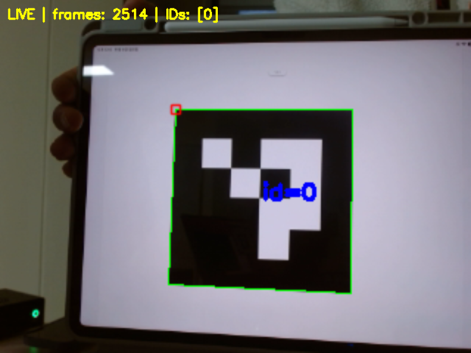

# Logitech C920 연결 및 보정

## 목표

Raspberry Pi에 USB로 연결한 C920의 영상을 다른 노트북에서 받고, 이 카메라 전용 내부 파라미터를 보정해 8주차 ArUco 실습에 사용한다. Ubuntu 22.04·ROS 2 Humble 기준이다. 카메라 노드는 Pi에서, 보정 GUI·검출·RViz·rosbag은 노트북에서 실행한다. 이 과정 자체에는 팔 브링업이 필요하지 않다.

## 과정

### 1. 터미널과 네트워크 준비

두 장치가 같은 Wi-Fi/아이폰 핫스팟에 연결되어 있어야 한다. SSH 접속 성공과 ROS 영상 수신 성공은 별개이므로 아래 토픽 검사까지 확인한다. 두 노트북을 쓰면 보정 GUI는 한 대에서만 실행한다.

**노트북 일반 터미널 — 최초 준비:**

```bash
sudo apt update
sudo apt install git python3-opencv python3-numpy python3-colcon-common-extensions \
  ros-humble-camera-calibration ros-humble-cv-bridge ros-humble-rviz2 ros-humble-rosbag2
# 이미 같은 경로에 저장소가 있으면 clone 대신 해당 저장소에서 git pull --ff-only
 git clone https://github.com/ktw25079/Intelligent_Robot_Practice.git ~/intelligent_robot_practice
cd ~/intelligent_robot_practice/week08
source /opt/ros/humble/setup.bash
colcon build --base-paths ire_week08_vision
source install/setup.bash
export ROS_DOMAIN_ID=4 ROS_LOCALHOST_ONLY=0
```

새 **일반 터미널마다** 다음을 적용한다. SSH 안에서는 Pi의 ROS 환경을 별도로 설정한다.

```bash
cd ~/intelligent_robot_practice/week08
source /opt/ros/humble/setup.bash
source install/setup.bash
export ROS_DOMAIN_ID=4 ROS_LOCALHOST_ONLY=0
```

### 2. Pi에 USB 카메라 연결·설정 복사

**일반 터미널**에서 실제 Pi 주소를 입력한다. 핫스팟 재접속 후 주소가 바뀔 수 있다.

```bash
read -rp 'Raspberry Pi IP: ' ROBOT_IP
ssh ubuntu@"$ROBOT_IP" 'mkdir -p ~/vision-usb'
scp ire_week08_vision/config/logitech_c920.yaml ubuntu@"$ROBOT_IP":~/vision-usb/
ssh ubuntu@"$ROBOT_IP"
```

**이후 SSH 터미널 — Pi에서:**

```bash
sudo apt update
sudo apt install ros-humble-v4l2-camera v4l-utils
lsusb
ls -l /dev/v4l/by-id/
```

[설정 파일](ire_week08_vision/config/logitech_c920.yaml)의 `video_device`는 실습한 C920의 고유 경로다. 다른 C920이면 위 목록의 실제 `video-index0` 경로로 수정한다. 이번 장치는 `/dev/video2`였지만 번호는 바뀔 수 있으므로 고유 경로를 사용한다.

```bash
nano ~/vision-usb/logitech_c920.yaml
source /opt/ros/humble/setup.bash
export ROS_DOMAIN_ID=4 ROS_LOCALHOST_ONLY=0
# 이미 같은 카메라 노드가 실행 중이면 중복 실행하지 않는다.
pgrep -af v4l2_camera_node
# 실행 중인 노드가 없을 때:
ros2 run v4l2_camera v4l2_camera_node --ros-args \
  -r __ns:=/logitech --params-file /home/ubuntu/vision-usb/logitech_c920.yaml
```

YUYV 입력을 RGB8 320×240으로 발행하며 15fps를 요청한다. 최초 실행에서 장치가 보고한 잘못된 기본 제어값 때문에 파라미터 오류가 발생해 밝기·대비·채도 등 유효한 값을 설정 파일에 명시했다. Pi CSI 카메라용 `camera_ros` 명령은 C920에 사용하지 않는다.

### 3. 노트북 영상 수신

**일반 터미널 — 공통 환경 설정 후:**

```bash
ros2 topic hz /logitech/image_raw
# 몇 초 확인한 뒤 Ctrl+C
python3 ire_week08_vision/scripts/view_logitech.py
```

영상 창은 Q 또는 Esc로 종료한다. 이 뷰어는 ArUco ID만 표시하며 미보정 카메라의 거리·자세를 계산하지 않는다.

### 4. 체커보드와 한 칸 크기

[보정용 PNG](markers/checkerboard_8x6.png)를 아이패드에 표시한다. QR/ArUco 마커가 아닌 체커보드이며 **사각형 9×7개, 내부 교차점 8×6개**이므로 `--size 8x6`을 사용한다. [20mm SVG 원본](markers/checkerboard_8x6_20mm.svg)은 실제 배율로 출력했을 때의 규격이며 화면 표시 크기를 보장하지 않는다.

`--square`는 흰 여백을 제외한 **한 칸의 실제 변 길이(m)**다. 전체 그림 크기나 ArUco 마커 크기를 넣지 않는다. 사용자가 여백 포함 약 14×11cm로 측정한 상태에서는 한 칸을 임시로 `0.0125m`로 두었다. 정확히 측정한 값이 아니므로 최종 실측값으로 교체하고, 보정 중에는 화면 확대·축소를 하지 않는다. 태블릿 화면의 반사·모아레와 체커보드 가로세로 왜곡을 줄인다.

### 5. 보정 GUI 실행

**일반 터미널 — SSH 안에서 실행하지 않는다:**

```bash
ros2 service list | grep /logitech/set_camera_info
ros2 run camera_calibration cameracalibrator --size 8x6 --square 0.0125 \
  --camera_name hd_pro_webcam_c920 --no-service-check --ros-args \
  -r image:=/logitech/image_raw \
  -r camera/set_camera_info:=/logitech/set_camera_info
```

서비스 이름 전체를 remap해야 한다. `camera:=/logitech`만 지정하는 방식은 사용하지 않는다. `--no-service-check`는 시작 시 서비스 대기 검사를 생략하는 옵션이며 COMMIT의 성공을 보장하지 않는다.

1. 체커보드를 영상의 중앙·좌우·상하로 이동하고, 가까이/멀리 및 여러 기울기로 보여 준다. 전체 교차점이 보이도록 유지한다.
2. X·Y·Size·Skew 표본을 충분히 모아 CALIBRATE가 활성화되면 누른다.
3. 계산 완료 후 SAVE로 자료를 저장하고, COMMIT으로 Pi의 `/logitech/set_camera_info`에 보정값을 전달한다. 성공 메시지를 확인한다.
4. 보정 해상도와 실제 사용 해상도를 320×240으로 유지한다. 초점·줌 설정이 바뀌면 기존 보정의 유효성을 다시 확인한다.

SAVE 파일은 **GUI를 실행한 노트북**의 `/tmp/calibrationdata.tar.gz`다. 보관하려면 일반 터미널에서:

```bash
mkdir -p results/c920_calibration
cp /tmp/calibrationdata.tar.gz results/c920_calibration/
tar -tzf results/c920_calibration/calibrationdata.tar.gz
ros2 topic echo /logitech/camera_info --once
```

`width=320`, `height=240`, K의 초점거리 값이 양수인지 확인한다. D는 실제 결과에 따라 0에 가까울 수 있다. K가 채워진 것만으로 거리 정확도가 검증된 것은 아니다.

**SSH 터미널 — COMMIT 후 Pi에 저장된 파일 확인:**

```bash
ls -lt ~/.ros/camera_info/
```

재실행 시 보정 파일이 다시 로드되는지 `camera_info`로 확인한다. 자동 로드되지 않으면 실제 생성된 YAML 경로를 지정해 카메라를 실행한다(기존 노드를 먼저 종료).

```bash
# 실제 파일명으로 바꿔 입력
read -rp 'Calibration YAML absolute path: ' CALIB_YAML
ros2 run v4l2_camera v4l2_camera_node --ros-args \
  -r __ns:=/logitech --params-file /home/ubuntu/vision-usb/logitech_c920.yaml \
  -p camera_info_url:="file://$CALIB_YAML"
```

Pi 카메라용 `pi_camera_320x240.yaml`을 C920 보정값으로 재사용하지 않는다.

### 6. 보정 도구의 로컬 설치 대안

원래 노트북에서는 sudo 권한 없이 공식 deb를 패키지 내부 `.local-tools/`에 풀어 실행했다. Ubuntu 22.04 amd64·Humble과 기존 GUI/Python 의존성이 있는 환경용이며, 모든 의존성을 설치하는 일반 대체 수단은 아니다. 새 노트북에는 위 apt 설치를 권장한다.

```bash
# 일반 터미널, week08/에서
bash ire_week08_vision/scripts/install_c920_calibration.sh
bash ire_week08_vision/scripts/calibrate_c920.sh 0.0125
```

설치 라이브러리·캐시와 실제 보정 완료 전의 추정 YAML은 저장소에 포함하지 않는다.

### 7. B-3 검출 및 B-4 기록·재생에 적용

**일반 터미널 — 보정값 확인 후 검출:**

```bash
ros2 run ire_week08_vision aruco_detect --ros-args \
  -p image_topic:=/logitech/image_raw \
  -p camera_info_topic:=/logitech/camera_info \
  -p frame_id:=logitech_optical_frame \
  -p marker_size:=0.13 -p show_windows:=true
```

`marker_size=0.13`은 당시 별도로 표시한 ArUco 검은 사각형 한 변의 약 13cm 실측값이다. 체커보드 한 칸 값과 다르다. 마커 표시 크기를 바꾸면 다시 측정한다.

다른 **일반 터미널**에서 `rviz2`를 실행한다. Fixed Frame을 `logitech_optical_frame`으로 지정하고 `/aruco/pose` Pose 및 `/aruco/image` Image 표시를 추가한다. C920 장착 위치의 TF는 측정하지 않았으므로 기존 Pi 카메라의 TF를 그대로 적용하지 않는다.

```bash
# 일반 터미널: 기록, 종료할 때 Ctrl+C (이미 존재하는 출력 폴더는 새 이름 사용)
ros2 bag record /logitech/image_raw /logitech/camera_info -o results/c920_bag
```

재생 전 **SSH 터미널**의 카메라를 Ctrl+C로 종료한다. 앞서 백그라운드로 실행했던 경우에는 아래 명령으로 C920 노드만 종료한다. 이때 실시간 보정 GUI도 먼저 종료한다.

```bash
pkill -INT -f '^/opt/ros/humble/lib/v4l2_camera/v4l2_camera_node.*__ns:=/logitech'
```

검출 노드를 새로 실행하고, **일반 터미널 두 개**에서 각각:

```bash
ros2 bag play results/c920_bag --rate 0.5
```

```bash
ros2 topic echo /aruco/pose --once
```

## 결과

C920 USB 인식, Pi 영상 발행, 노트북 화면 표시와 ArUco ID 0 검출을 확인했다. 20초 검사에서 영상 125개·CameraInfo 129개를 받았다. 이는 검사 노드의 수신 수이며 카메라 자체 FPS 측정값은 아니다.



[보정 전 검사값](results/logitech_before_calibration.json)의 K는 모두 0이고 D는 비어 있었다. 보정 도구 설치·체커보드 준비·실행 방법까지 확인했으며, **최종 보정값 저장·COMMIT 성공·C920으로 pose 및 rosbag 재생 성공은 아직 확인하지 않았다.** 기존 week08의 pose 캡처와 bag 결과는 Pi CSI 카메라로 얻은 별도 결과다.
