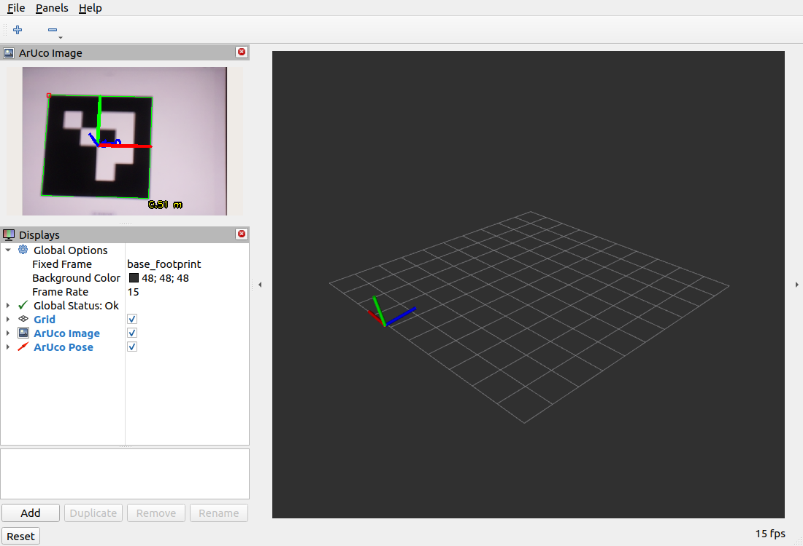
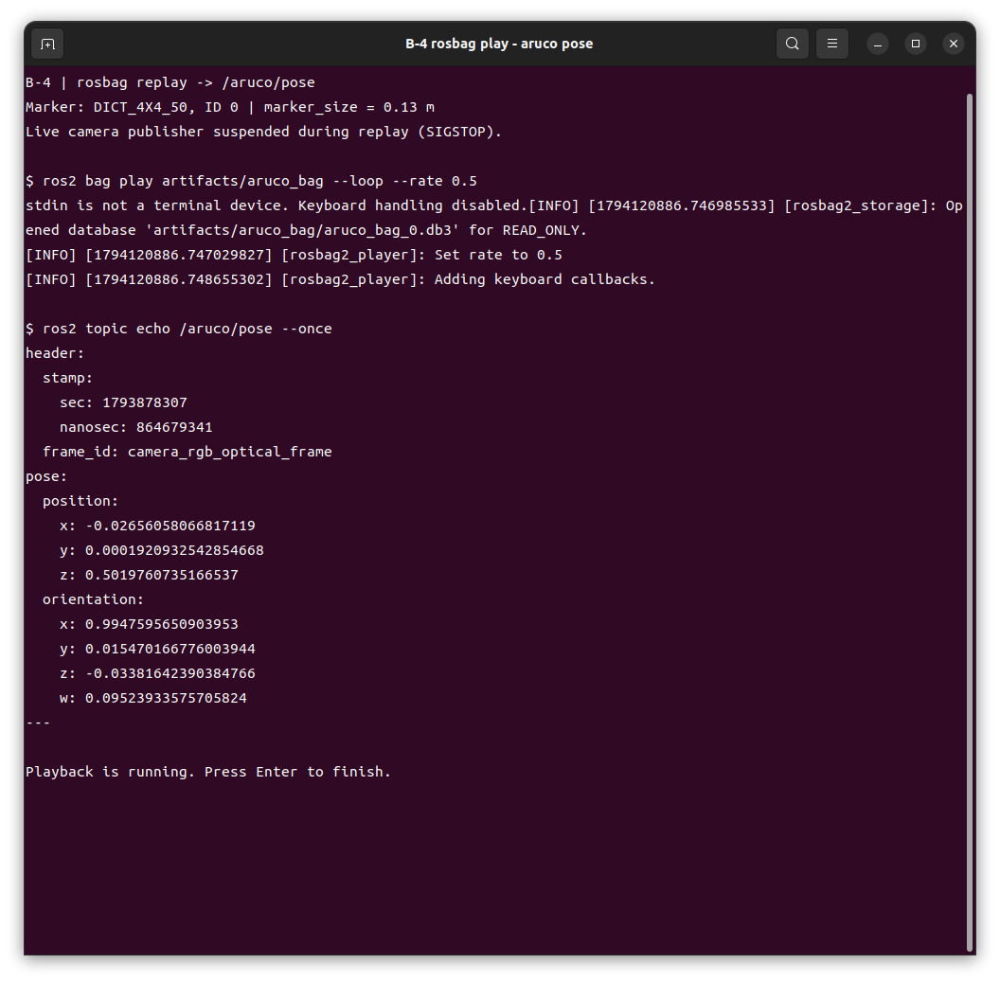

# week08 실습 정리

## 목표

- 실물 Pi 카메라의 영상과 보정 정보를 받아 ArUco ID·위치·자세를 확인한다.
- 같은 입력을 rosbag으로 기록하고 재생하여 검출 결과를 재현한다.

## 과정

### Logitech C920 USB 카메라 대체 사용

C920의 Pi 연결·노트북 영상 수신·ArUco ID 0 검출을 확인했다. [C920 연결 및 보정 방법](C920_CALIBRATION.md)에 일반 터미널/SSH 구분, 다른 노트북 설치, 체커보드 보정, 저장·적용 확인과 B-3/B-4 변경 명령을 정리했다. 최종 C920 보정과 pose 재생 검증은 아직 완료 확인 전이며, 아래 기존 결과는 Pi CSI 카메라 실습이다.


### 1. 카메라 연결과 실행 코드

Ubuntu 22.04·ROS 2 Humble PC와 Raspberry Pi를 `ROS_DOMAIN_ID=4`로 연결했다. 정상 동작하던 조의 IMX219 카메라를 장착한 뒤 320×240 영상 수신을 확인했다. 아이패드에 `DICT_4X4_50`의 ID 0 마커를 띄우고, 검은 사각형 한 변을 약 13cm로 측정해 `marker_size=0.13`을 적용했다.

실행 코드는 [강의 저장소의 8주차 예제](https://github.com/iCIRLab/icir_ire_lecture/tree/master/ire_week08_vision)를 가져와 실물 토픽으로 실행했다. 직접 새 검출 알고리즘을 작성한 것은 아니다. 패키지에 ArUco 실행 진입점, `geometry_msgs` 의존성, 보정·RViz 설정 설치를 반영했다.

| 파일 | 역할 |
| --- | --- |
| [aruco_detect.py](ire_week08_vision/ire_week08_vision/aruco_detect.py) | 영상·CameraInfo 구독 → ID 검출 → pose 및 표시 영상 발행 |
| [color_detect.py](ire_week08_vision/ire_week08_vision/color_detect.py) | HSV 빨강 검출, `/red_pillar/exists` 발행 |
| [generate_aruco.py](ire_week08_vision/ire_week08_vision/generate_aruco.py) | 흰 여백을 포함한 ID 0~9 마커 생성 |
| [보정 파일](ire_week08_vision/config/pi_camera_320x240.yaml) | 강의 제공 320×240 카메라 행렬·왜곡계수 |
| [RViz 설정](ire_week08_vision/config/vision_lab.rviz) | `base_footprint` 기준 검출 영상·pose 좌표축 표시 |
| [check_topics.py](scripts/check_topics.py) | 정해진 시간 동안 영상·보정·pose 수신 수와 검출 ID 저장 |
| [ID 0 마커](markers/aruco_0.png) | 아이패드 표시용 이미지 |

### 2. PC 패키지 준비

아래는 일반 설치 환경에서의 재현 명령이다. 저장소를 `~/intelligent_robot_practice`에 받은 상태로 실행한다. 패키지에는 실물 카메라 예제만 포함하며 Gazebo 월드는 포함하지 않는다.

```bash
sudo apt install python3-opencv python3-numpy python3-colcon-common-extensions \
  ros-humble-cv-bridge ros-humble-geometry-msgs ros-humble-rviz2 ros-humble-rosbag2
source /opt/ros/humble/setup.bash
cd ~/intelligent_robot_practice/week08
colcon build --base-paths ire_week08_vision
source install/setup.bash
export ROS_DOMAIN_ID=4 ROS_LOCALHOST_ONLY=0
```

실습 당시에는 기존 `camera_ros`·libcamera 설치와 로봇의 TurtleBot3 Manipulation 작업공간을 사용했다. 카메라 설치 자체를 위 PC 패키지가 수행하지는 않는다.

### 3. 로봇 카메라와 PC 검출 실행

PC의 `week08/`에서 보정 파일을 로봇에 복사한다. `<로봇 IP>`는 해당 로봇 주소로 바꾼다.

```bash
ssh ubuntu@<로봇 IP> 'mkdir -p ~/.ros/camera_info'
scp ire_week08_vision/config/pi_camera_320x240.yaml ubuntu@<로봇 IP>:~/.ros/camera_info/
```

**로봇 SSH 터미널 — 카메라:**

```bash
source /opt/ros/humble/setup.bash
export ROS_DOMAIN_ID=4 ROS_LOCALHOST_ONLY=0
export LD_LIBRARY_PATH=/usr/local/lib/aarch64-linux-gnu:$LD_LIBRARY_PATH
ros2 run camera_ros camera_node --ros-args \
  -p format:=RGB888 -p width:=320 -p height:=240 \
  -p camera_info_url:=file:///home/ubuntu/.ros/camera_info/pi_camera_320x240.yaml
```

**로봇 별도 SSH 터미널 — TF와 하드웨어 브링업:**

```bash
source /opt/ros/humble/setup.bash
source ~/turtlebot3_ws/install/setup.bash
# 이번 로봇은 이전 실습에서 수정한 하드웨어·SDK overlay도 사용했다.
source ~/lecture05-repair_ws/install/setup.bash
export ROS_DOMAIN_ID=4 ROS_LOCALHOST_ONLY=0
ros2 launch turtlebot3_manipulation_bringup hardware.launch.py
```

이번 실행에서 팔 제어기 초기화는 실패했지만 `robot_state_publisher`는 실행되어 `base_footprint → camera_rgb_optical_frame`의 정적 TF를 확인했다. 팔 정상 구동을 확인한 실습은 아니다.

**PC 터미널 1 — `week08/`에서 검출:**

```bash
source /opt/ros/humble/setup.bash
source install/setup.bash
export ROS_DOMAIN_ID=4 ROS_LOCALHOST_ONLY=0
ros2 run ire_week08_vision aruco_detect --ros-args \
  -p image_topic:=/camera/image_raw -p camera_info_topic:=/camera/camera_info \
  -p marker_size:=0.13 -p show_windows:=true
```

**PC 터미널 2 — 같은 환경 설정 후 표시·확인:**

```bash
rviz2 -d ire_week08_vision/config/vision_lab.rviz
# 별도 터미널에서
ros2 topic echo /aruco/pose --once
```

### 4. rosbag 기록과 재생

카메라 실행 중 `/camera/image_raw`와 `/camera/camera_info`를 함께 기록했다. 녹화 명령은 15초 실행했으며, 발견·연결 시간을 제외하고 저장된 메시지 구간은 약 6.125초다.

```bash
# PC의 week08/에서 새 기록 생성; 끝낼 때 Ctrl+C
ros2 bag record /camera/image_raw /camera/camera_info -o results/new_aruco_bag
# 저장된 실습 데이터 재생
ros2 bag play results/aruco_bag --rate 0.5
# 별도 터미널
ros2 topic echo /aruco/pose --once
```

재생 전에 실시간 카메라 발행을 중단해야 입력이 섞이지 않는다. 이번에는 카메라 종료·재실행 시 커널 오류가 있었으므로 로봇의 **카메라 실행 바이너리 PID만** `kill -STOP <PID>`로 일시 정지했다. 5초 동안 영상·보정·pose가 모두 0건임을 확인한 뒤, 검출 노드를 새로 시작해 기존 보정 캐시 없이 재생했다. 검증 후 `kill -CONT <같은 PID>`로 실시간 수신을 복구했다. 이는 카메라 노드를 완전히 종료하는 절차와는 다르다.

로봇 없이 bag만 확인할 때는 실시간 카메라를 실행하지 않고, RViz의 Fixed Frame을 `camera_rgb_optical_frame`으로 바꿀 수 있다. 저장된 화면의 `base_footprint` 표시는 로봇이 제공한 TF를 사용한 결과다.

검증 도구는 `python3 scripts/check_topics.py results/check 20`으로 20초 수신 결과를 저장한다. `check_topics.py`는 실습 환경인 OpenCV 4.5.4 기준이다.

## 결과

### RViz 영상·pose 표시

ID 0의 검출 테두리, 영상 위 좌표축, 3차원 pose 좌표축과 `Global Status: Ok`를 확인했다. 아래 화면은 저장한 bag을 재생하면서 촬영했다.



### rosbag 재생 중 pose 출력

실시간 카메라 발행을 정지한 상태에서 bag을 재생했다. 캡처의 `position.z`는 약 0.502m이고 프레임은 `camera_rgb_optical_frame`이다.



| 확인 항목 | 실제 결과 |
| --- | --- |
| 카메라 입력 | 320×240, 보정 행렬 K·왜곡계수 D 수신 |
| 실시간 검출 | ID 0, 마지막 pose의 z ≈ 0.495m |
| 저장한 bag | 영상 28개 + CameraInfo 32개, 총 60개 메시지 |
| 0.5배속 재생 | 영상 28개·CameraInfo 32개 수신, ID 0 검출, pose 28개 발행 |
| 재생 마지막 pose | x=-0.01956m, y=-0.00565m, z=0.51014m |
| 실시간 복구 검사 | 10초간 영상 29개·CameraInfo 25개 수신; 그 구간에는 마커 미검출 |
| 참고 색 검출 | `/red_pillar/exists`에서 `false` 수신; 빨간 물체 검출 성공 시험은 하지 않음 |

[검증값](results/verification.json) · [rosbag 메타데이터](results/aruco_bag/metadata.yaml) · [rosbag DB](results/aruco_bag/aruco_bag_0.db3) · [재생 영상 프레임](results/replayed_camera.jpg)

수신 수는 검사 노드별 수신량으로 센서 자체 FPS나 누락률을 뜻하지 않는다. 실제 검은 사각형은 약 13cm로 측정했고, 보정값은 해당 카메라를 새로 보정한 값이 아닌 강의 제공값이므로 거리·자세의 절대 정확도는 검증하지 않았다. 로봇과 PC의 시계가 달라 메시지 시각과 PC 기록 시각에도 차이가 있다.

### 카메라 촬영 시간 초과와 교체 확인

기존 카메라는 IMX219 센서 인식과 320×240 스트림 설정까지 성공했지만, 실제 촬영 단계에서 프레임을 받지 못했다. 아래는 당시 실행 로그에서 발췌한 핵심 오류 3줄이다. 센서가 목록에 나타나는 것만으로 실제 영상 전송까지 정상이라고 판단할 수 없었다.

```text
[1:09:59.815852367] [3418] ERROR RPI pipeline_base.cpp:1333 Camera frontend has timed out!
[1:09:59.815961261] [3418] ERROR RPI pipeline_base.cpp:1334 Please check that your camera sensor connector is attached securely.
[1:09:59.816109596] [3418] ERROR RPI pipeline_base.cpp:1335 Alternatively, try another cable and/or sensor.
```

[오류 로그 원문 발췌](results/camera_timeout_excerpt.log)

| 확인 순서 | 조치 | 관찰 결과 |
| --- | --- | --- |
| 1 | 기존 카메라에 새 리본케이블을 연결하고 커넥터를 다시 눌러 확인 | 같은 촬영 시간 초과 발생, 노트북 25초 수신 검사에서 0프레임 |
| 2 | 기존 리본케이블로 다시 교체 | 동일 오류 재현, 노트북 25초 수신 검사에서 0프레임 |
| 3 | 정상 동작하던 다른 조의 카메라 모듈로 교체 | 영상 수신 성공, 이후 ArUco ID 0·pose 검출과 rosbag 재생 검증 성공 |

리본케이블을 바꾸는 것만으로는 해결되지 않았고, 정상 카메라 모듈로 교체한 뒤 실습을 진행할 수 있었다. 이 비교 결과는 기존 카메라 모듈 또는 모듈 쪽 커넥터 문제를 의심하게 하지만, 센서 자체 고장인지 접촉 문제인지는 분리해서 확정하지 않았다. 보정 파일 누락 메시지도 함께 있었으나, 촬영 시간 초과와는 구분하여 기록했으며 이후 강의 보정 파일을 적용했다.

### 그 밖의 오류 확인 범위

- 카메라 재시작 중 장치 경로 읽기에서 커널 오류가 발생했다. 소프트웨어 재부팅 후 SSH가 복구되지 않아 전원을 다시 켠 뒤 영상 수신을 복구했다.
- 팔 브링업은 `Not connected manipulator`로 실패했다. 읽기 전용 PING/READ 3회 모두 OpenCR 통신은 성공했고 팔 연결 값은 0, 바퀴 연결 값은 1, 입력 전압은 12.11~12.15V였다. 이전 수정 드라이버·SDK도 적용 중이다. [진단 결과](results/arm_diagnostic.json)에 기록했으며 이번에는 팔 동작·개별 모터 고장을 확인하거나 수리하지 않았다.
