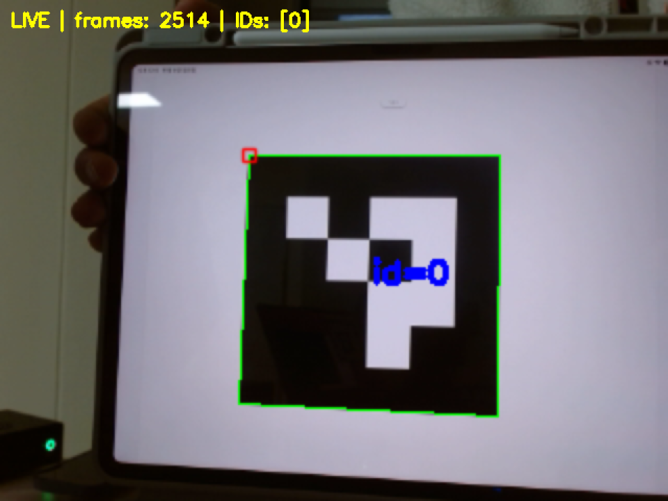

# week08 실습 정리

[전체 실습](../README.md) · [재현 환경](../docs/REPRODUCIBILITY.md) · [검증 근거](../docs/EVIDENCE.md)

실물 카메라의 ArUco 검출을 영상·pose·rosbag으로 확인했다. CSI 카메라의 재생 검증과 C920의 미보정 ID 검출 결과를 구분한다.

## 목표

- 실물 카메라 영상에서 ArUco ID와 위치·자세를 확인한다.
- 영상과 CameraInfo를 rosbag으로 기록하고 재생해 검출을 재현한다.

## 과정

### 1. Pi 카메라로 검출·기록·재생

Ubuntu 22.04·ROS 2 Humble에서 Raspberry Pi 카메라 영상 320×240과 보정 정보를 노트북으로 받았다. 아이패드에 `DICT_4X4_50` ID 0을 표시하고 검은 사각형의 한 변을 약 13cm로 측정해 `marker_size=0.13`을 적용했다. `ROS_DOMAIN_ID=4`, `ROS_LOCALHOST_ONLY=0`으로 통신했다.

[강의 예제](https://github.com/iCIRLab/icir_ire_lecture/tree/master/ire_week08_vision)를 실물 토픽으로 실행하고 ArUco 실행 진입점, 의존성과 설정 설치를 패키지에 반영했다. 영상·CameraInfo를 기록한 뒤 실시간 입력을 일시 정지하고 검출 노드를 새로 실행해 bag 재생 결과를 확인했다.

| 코드·자료 | 역할 |
| --- | --- |
| [aruco_detect.py](ire_week08_vision/ire_week08_vision/aruco_detect.py) | 영상·보정 구독, ID 검출, pose·표시 영상 발행 |
| [generate_aruco.py](ire_week08_vision/ire_week08_vision/generate_aruco.py) | ID 0~9 마커 생성 |
| [color_detect.py](ire_week08_vision/ire_week08_vision/color_detect.py) | 참고 HSV 빨강 검출 예제 |
| [카메라 보정값](ire_week08_vision/config/pi_camera_320x240.yaml) · [RViz 설정](ire_week08_vision/config/vision_lab.rviz) | 강의 제공 보정값과 영상·pose 표시 |
| [check_topics.py](scripts/check_topics.py) | 일정 시간 수신량·검출 ID·pose 기록 |

최초 설치, 빌드, Pi 카메라·TF, PC 검출, rosbag 기록·재생 명령은 [Pi 카메라 실행 안내](docs/pi-camera-workflow.md)에 정리했다. 카메라 교체와 팔 초기화 오류의 근거는 [문제 확인 기록](docs/troubleshooting.md)에서 확인할 수 있다.

### 2. C920 USB 카메라 연결

추가로 C920을 Pi에 연결해 노트북 영상 수신과 ID 0 검출을 확인했다. CSI 카메라와 입력 토픽·장치·보정값이 다르므로 별도 설정을 사용한다. [C920 연결 및 보정 안내](C920_CALIBRATION.md)에 설치, 체커보드, 보정 GUI와 적용 절차를 정리했다.

## 결과

### Pi CSI 카메라: ID·pose 및 rosbag 재생 확인

| 확인 항목 | 실제 결과 |
| --- | --- |
| 입력 영상 | 320×240, CameraInfo의 K·D 수신 |
| 실시간 검출 | ID 0, 마지막 pose z≈0.495m |
| 저장 bag | 약 6.125초, 영상 28개·CameraInfo 32개 |
| 0.5배속 재생 | 영상 28개·CameraInfo 32개 수신, ID 0 검출, pose 28개 |
| 재생 마지막 위치 | x=-0.01956m, y=-0.00565m, z=0.51014m |
| 입력 복구 | 10초간 영상 29개·CameraInfo 25개; 해당 구간 마커 미검출 |

[검증값](results/verification.json) · [bag 메타데이터](results/aruco_bag/metadata.yaml) · [bag DB](results/aruco_bag/aruco_bag_0.db3) · [재생 프레임](results/replayed_camera.jpg)

검사 노드별 수신 수는 센서 FPS나 누락률이 아니다. 약 13cm의 마커 실측값과 강의 제공 보정값을 사용했으므로 거리·자세의 절대 정확도는 검증하지 않았다. Pi와 PC의 시계 차이도 있었다. 팔 초기화는 실패했지만 카메라 정적 TF는 확인했으며, 팔 정상 구동을 확인한 결과는 아니다.

### C920: 영상·ID 확인, 보정 완료 미확인

20초 검사에서 영상 125개·CameraInfo 129개와 ID 0을 확인했다. [당시 검사값](results/logitech_before_calibration.json)의 K는 모두 0이고 D는 비어 있었다. **최종 보정값 저장·COMMIT, C920의 pose·bag 재생은 아직 검증하지 않았다.** 위 pose·bag 결과는 CSI 카메라로 얻은 결과다.

기존 CSI 카메라는 두 리본케이블에서 촬영 시간 초과가 재현됐고, 정상 동작하던 다른 카메라 모듈로 교체한 뒤 수신에 성공했다. 모듈과 커넥터 중 어느 부품의 문제인지는 확정하지 않았다. [오류 로그](results/camera_timeout_excerpt.log) · [비교 과정과 추가 진단](docs/troubleshooting.md)
