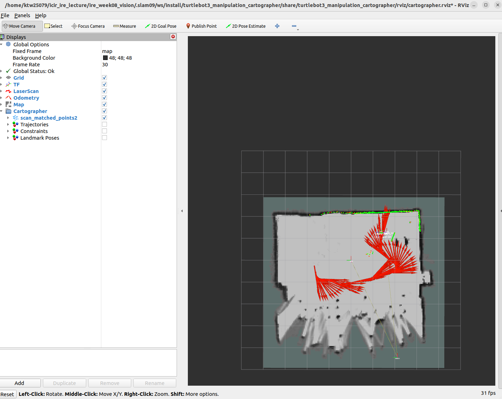
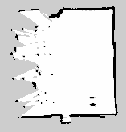
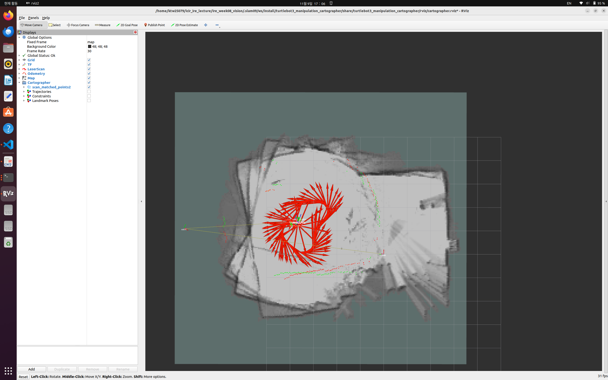

# week09 실습 정리

[전체 실습](../README.md) · [재현 환경](../docs/REPRODUCIBILITY.md) · [검증 근거](../docs/EVIDENCE.md)

실물 LiDAR 지도의 이중벽을 관찰하고 저속 제한 후 다시 매핑했다. 원본 지도·실행 로그·캡처로 변화와 남은 한계를 기록했다.

## 목표

- 실물 TurtleBot3의 LiDAR·odometry로 강의실 지도를 작성한다.
- 키보드 주행 속도를 낮춰 스캔 정합을 개선하고, 지도를 저장·재로드한다.

## 과정

### 1. 환경과 실행 코드

Ubuntu 22.04·ROS 2 Humble 노트북과 Raspberry Pi를 같은 휴대폰 핫스팟에 연결했다. Pi는 하드웨어 bringup, 노트북은 Cartographer·MoveIt Servo·teleop·지도 저장을 담당한다. 양쪽에서 `ROS_DOMAIN_ID=4`, `ROS_LOCALHOST_ONLY=0`을 사용하며 SSH 접속과 양방향 ROS 테스트 메시지 수신을 각각 확인했다.

| 파일 | 역할 |
| --- | --- |
| [build.sh](scripts/build.sh) | mission2의 기존 패키지 4개와 저속 teleop 빌드 |
| [env.sh](scripts/env.sh) | ROS 환경·실물 통신 그룹 설정 |
| [run.sh](scripts/run.sh) | 지도·Servo·teleop 실행 및 날짜별 지도 저장 |
| [teleop 헤더](turtlebot3_manipulation_teleop/include/turtlebot3_manipulation_teleop/turtlebot3_manipulation_teleop.hpp) | 직진·회전 명령 상한 설정 |
| [teleop 소스](turtlebot3_manipulation_teleop/src/turtlebot3_manipulation_teleop.cpp) | 키 입력에 따른 속도 증감 및 Space 정지 |

ROBOTIS 기반 소스는 [mission2 작업공간](../mission2/workspaces/README.md)을 사용한다. 이 폴더의 teleop은 당시 실행한 소스이며, 기존 상한 `0.26m/s`, `1.8rad/s`를 매핑용 `0.05m/s`, `0.2rad/s`로 낮췄다. 나머지 bringup·Cartographer·로봇 모델·MoveIt 설정은 mission2 소스를 재사용한다.

### 2. 노트북 설치와 빌드

ROS 2 Humble과 C++ 빌드 도구가 설치된 환경에서 저장소의 `week09/`로 이동한다.

```bash
sudo apt install python3-colcon-common-extensions build-essential \
  ros-humble-cartographer-ros ros-humble-nav2-map-server \
  ros-humble-moveit-servo ros-humble-moveit-kinematics \
  ros-humble-control-msgs ros-humble-xacro ros-humble-rviz2
cd ~/intelligent_robot_practice/week09
bash scripts/build.sh
```

### 3. 실물 bringup → 지도 작성

Pi의 설치·하드웨어 준비는 [mission2 실행 안내](../mission2/docs/setup-and-run.md)를 따른다. 충전기를 분리하고 로봇 배터리를 연결한 뒤 바닥에 배치하고 팔 주변 공간을 확보한다. 핫스팟의 현재 Pi 주소로 SSH 접속한다.

```bash
ssh ubuntu@<현재_Pi_IP>
# Pi에서: 기존 점검 및 하드웨어 보정 overlay를 포함한 실행
bash ~/lecture05-setup/bringup-robot.sh
```

실습 당시 이 스크립트가 사용하는 `lecture05-setup`, `turtlebot3_ws`, `lecture05-repair_ws`가 Pi에 준비되어 있었다. 새 Pi에서는 mission2의 설치·보정 절차를 먼저 완료해야 한다. bringup의 핵심 명령은 `ros2 launch turtlebot3_manipulation_bringup hardware.launch.py`다.

**노트북의 별도 터미널 3개**에서 각각 `week09/`로 이동한 뒤 실행한다.

```bash
bash scripts/run.sh map     # 터미널 1: Cartographer + RViz
bash scripts/run.sh servo   # 터미널 2: use_sim:=false
bash scripts/run.sh teleop  # 터미널 3: 저속 키보드 운전
```

`i/k`는 직진 속도를 ±0.01m/s, `j/l`은 회전 속도를 ±0.1rad/s씩 바꾼다. **키를 놓아도 마지막 명령이 유지되므로 Space로 정지**한다. Space로 정지한 뒤 Esc로 운전 프로그램을 종료한다. 동시에 여러 teleop을 실행하지 않는다.

Cartographer는 실물 기본값 `use_sim=false`, LiDAR+odom 설정 `use_odometry=true`, `use_imu_data=false`를 사용한다. IMU 토픽 발행과 SLAM에서 IMU를 사용하는 것은 별개다.

### 4. 저장과 초기화

Space로 정지하고 Cartographer가 실행 중인 상태에서 별도 터미널로 저장한다.

```bash
bash scripts/run.sh save
# results/sessions/날짜_시간/map.pgm + map.yaml 생성
```

초기화하려면 정지 후 **지도 터미널만 Ctrl+C로 종료하고 `bash scripts/run.sh map`을 재실행**한다. RViz의 Reset은 Cartographer 지도 초기화가 아니다. bringup과 Servo는 유지할 수 있다.

## 결과

### 저속 주행 후 지도



초기 지도보다 상단·좌우 벽이 선명해졌지만 일부 가장자리의 미관측 영역과 번짐은 남았다. 빨간 화살표는 RViz의 Odometry 표시이며 저장된 점유격자 이미지에는 포함되지 않는다. 화면은 저장 이후 사용자가 제공한 캡처다.

| 확인 항목 | 관찰 결과 |
| --- | --- |
| 하드웨어 사전 점검 | OpenCR 12.19V, 팔·바퀴 연결 인식, 점검 실패 항목 없음 |
| 컨트롤러 | joint_state·arm·diff_drive·imu·gripper 5개 active |
| 센서 처리 로그 | scan 약 4.8~5Hz, odom 약 4Hz |
| 저장 지도 | 157×165셀, 해상도 0.05m/셀, 원점 (-4.95, -4.24, 0) |
| 파일 재로드 | 별도 로컬 ROS 그룹에서 map_server의 읽기·configure·activate 성공 |



[지도 PGM](results/map.pgm) · [지도 YAML](results/map.yaml) · [PNG 미리보기](results/map_preview.png) · [검증 기록](results/verification.json)

지도 배열의 범위는 약 7.85×8.25m이며 미관측 영역을 포함한다. 강의실의 실제 치수나 주행 거리로 해석하지 않는다. 재로드 서버의 토픽 echo는 제한 시간 안에 수신하지 못했으며, 파일 읽기와 활성화 로그로 재로드 성공을 확인했다. 전체 강의실 주행·출발점 복귀·루프 클로저 성공과 벽 위치의 정량 정확도는 별도로 검증하지 않았다.

### 이중벽 발생과 속도 제한

<details>
<summary>초기 지도와 실제 속도 로그</summary>



[초기 주행 로그](results/fast_teleop_excerpt.log)에서 직진 명령 0.26m/s, 회전 명령 1.5rad/s가 확인됐다. LiDAR 약 5Hz 기준으로 회전 명령이 그대로 실현된다면 스캔 사이 회전량은 약 17°다. 실제 회전량을 측정한 값은 아니지만 빠른 회전을 정합 불량의 주요 후보로 보고 속도 상한을 낮췄다.

[저속 주행 로그](results/slow_teleop_excerpt.log)와 [Cartographer 로그](results/cartographer_excerpt.log)를 함께 보관했다. 지도 초기화와 저속 주행 후 벽의 겹침은 시각적으로 줄었으나, 동일 경로의 통제 실험은 아니므로 개선량을 수치화하지 않았다. 일부 스캔 포인트 폐기 경고와 낮은 odom 처리 빈도도 남아 있어 속도만을 유일한 원인으로 단정하지 않는다.

</details>
